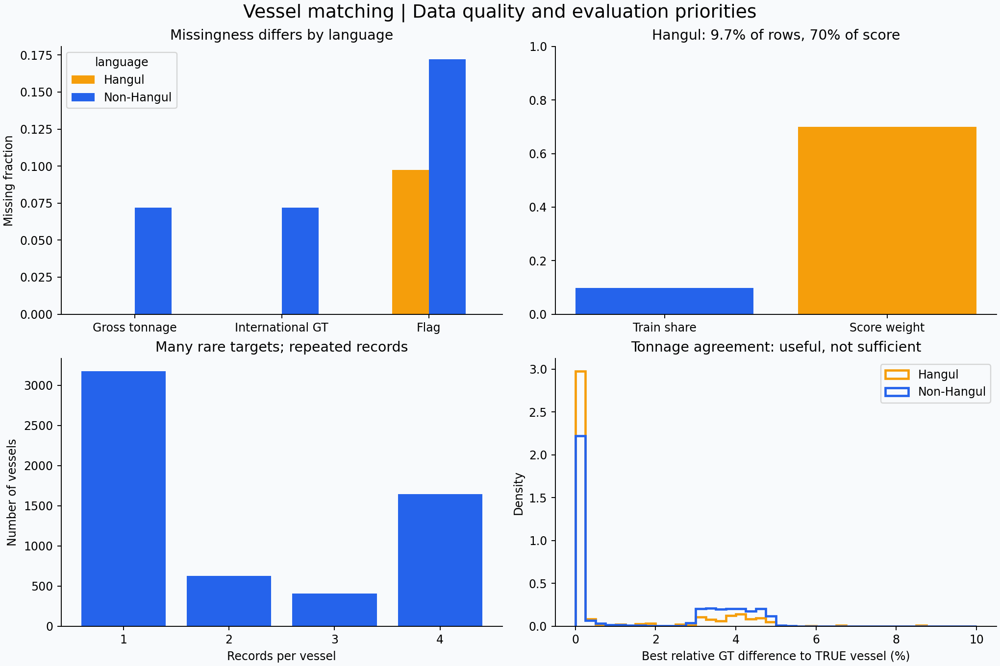
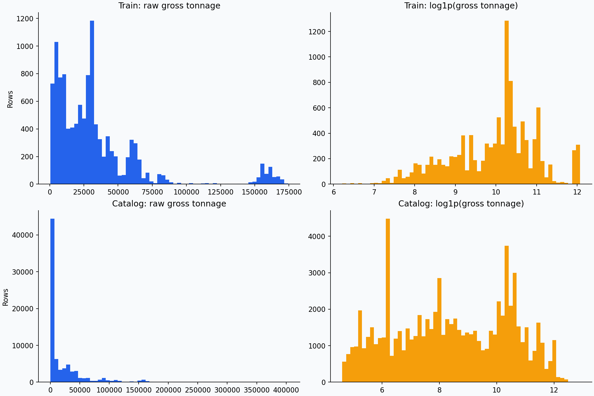
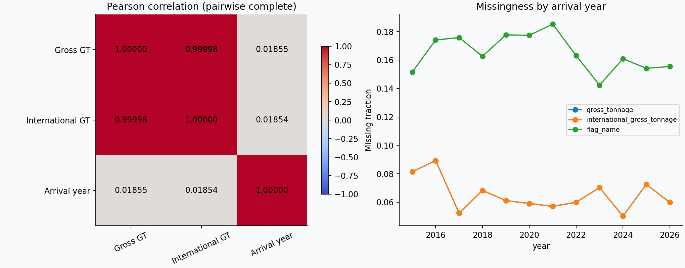

# 선박 정보 매칭 데이터 분석 리포트

분석 대상은 업로드된 공식 `train.csv`, `vessel_catalog.csv`입니다. 아래 수치는 실제 파일에서 계산했습니다. 비공개 `test.csv`는 없으며 테스트 분포를 추정하거나 집계하지 않았습니다.

## 과제와 데이터 개요

| 항목 | 확인 결과 |
|---|---|
| 과제 | 입출항 기록 한 행과 같은 선박을 카탈로그에서 찾는 개체 매칭·후보 순위화 |
| 최종 타겟 | `target_vessel_id` — 카탈로그의 `vessel_id` 한 개 |
| 학습 데이터 | 12,222행 × 9컬럼, 정답 선박 5,851척 |
| 카탈로그 | 78,595행 × 8컬럼, 선박 ID 중복 없음 |
| 후보 쌍 모델의 타겟 | `is_match = (candidate_vessel_id == target_vessel_id)`인 이진 라벨 |
| 시간 범위 | `arrival_year` 2015–2026년, 연 단위 정보만 존재 |
| 평가 | `0.7 × 한글 기록 정확도 + 0.3 × 비한글 기록 정확도` |
| 한글 정의 | 제공 공식 베이스라인과 동일하게 선박명에 `[가-힣]` 포함 여부 |

입력에는 선박명, 익명화 호출부호, 총톤수, 국제총톤수, 국적, 선종, 입항 연도가 있습니다. 카탈로그에는 선박명, 선종, 크기와 단위, 재화중량톤수, 총톤수, 국적이 있습니다. 입력과 카탈로그의 국적·선종 표기는 서로 다른 언어와 분류 체계입니다.

학습에 정답으로 등장한 선박은 전체 카탈로그의 **7.44%**입니다. 따라서 5,851개 학습 ID만 출력 가능한 일반 다중 클래스 분류기는 미관측 선박을 선택할 수 없습니다. 카탈로그 후보를 검색한 뒤 각 후보와 입력을 비교하는 구성이 적합합니다.

`df.info()`, `df.describe()`, `df.head()` 결과는 `output/df_info.txt`, `output/*_describe.csv`, `output/*_head.csv`에 저장했습니다.

## 1. 데이터 무결성 및 품질 진단

### 결측 비율과 발생 패턴

| 데이터 | 컬럼 | 결측 수 | 비율 |
|---|---|---:|---:|
| 학습 | `gross_tonnage` | 793 | 6.49% |
| 학습 | `international_gross_tonnage` | 793 | 6.49% |
| 학습 | `flag_name` | 2,015 | 16.49% |
| 카탈로그 | `size` | 6,563 | 8.35% |
| 카탈로그 | `deadweight_tonnage` | 5,592 | 7.11% |
| 카탈로그 | `gross_tonnage` | 214 | 0.27% |
| 카탈로그 | `unit` | 1 | 0.0013% |

학습의 나머지 컬럼은 결측이 없습니다. 두 입력 톤수는 **항상 함께 결측**이며, 하나만 비어 있는 행은 없습니다.

| 톤수 2개 | 국적 | 행 수 |
|---|---|---:|
| 있음 | 있음 | 9,632 |
| 있음 | 없음 | 1,797 |
| 없음 | 있음 | 575 |
| 없음 | 없음 | 218 |

톤수 결측률은 한글 기록 **0%**, 비한글 기록 **7.19%**입니다. 국적 결측률은 한글 **9.74%**, 비한글 **17.22%**입니다. 관측된 언어 그룹에 따라 결측 패턴이 다르므로 모든 결측을 동일한 무작위 손실로 취급하는 것은 부적절합니다. 입력 경로나 수집·표기 체계 차이가 가능한 설명이지만, 데이터만으로 원인을 확정하거나 MAR/MNAR로 단정할 수는 없습니다. 탐색적 카이제곱 결과는 JSON에 저장했으나 반복 선박으로 행 독립성 가정이 깨질 수 있으므로 그 p값을 확정적 근거로 사용하지 않습니다.

**권장 대체 전략은 원래 제원값을 임의로 채우기보다 관측 여부를 보존하는 방식입니다.**

- 톤수가 없을 때 전체 평균·중앙값으로 원본을 채워 후보를 검색하면 가짜 톤수 일치가 생깁니다. 해당 톤수 검색 경로를 생략하고 이름·발음·선종 등의 경로를 사용합니다.
- 쌍별 톤수 오차는 `NaN`으로 두고 결측 표시를 함께 만듭니다. LightGBM은 결측을 직접 처리할 수 있고, 선형 모델에서는 **학습 후보 쌍에서만** 중앙값 대체를 학습합니다. 기존 제출 베이스라인의 오차 결측값 `2.0`도 정상 상대 오차 범위 밖의 고정 센티널과 결측 표시를 함께 쓰는 구현입니다.
- 국적·단위 결측은 `__MISSING__` 범주로 보존합니다. 최빈 국적을 넣지 않습니다.
- `size`는 단위가 알려진 경우에만 같은 단위·선종 내에서 대체를 검토합니다. 이 과제의 입력에는 직접 비교할 `size`가 없어, 초기 모델에서는 생략해도 됩니다.
- 정답 선박 5,851척의 카탈로그 총톤수에는 결측이 없었습니다. 이는 카탈로그 전체 214척의 결측에 대해 모델이 충분히 학습했다고 볼 수 없음을 뜻합니다. 결측 경로의 실행 검사를 따로 둡니다.

### 무결성·중복·표기 노이즈

- `sample_id`와 카탈로그 `vessel_id`는 각각 고유하며, 모든 학습 정답이 카탈로그에 존재합니다.
- `sample_id`와 정답을 제외한 입력값이 완전히 같은 중복 행이 **1,000행** 있습니다. 같은 입력 묶음에 정답이 충돌하는 사례는 없습니다.
- 선박명과 두 톤수만 기준으로 하면 중복이 **6,103행**입니다. 반복 입출항 또는 자료 생성·정제 특성일 수 있으므로 오류로 단정하여 삭제하지 않습니다. 분할을 먼저 하고, 학습 내 중복 가중치·계산량을 조정하는 것이 적절합니다. 공식 평가 지표는 기록 단위로 계산합니다.
- 호출부호 5,851개는 학습 데이터에서 정답 선박과 일대일입니다. 정규화 이름도 관측 학습 데이터에서는 서로 다른 ID에 중복 대응하지 않습니다. 이는 테스트에서도 항상 성립한다는 보장이 아닙니다.
- 정답 카탈로그 이름과 대소문자·공백·구두점 정규화 후 일치하는 비율은 **58.39%**입니다. 정규화만으로 해결되지 않는 음역·철자·명칭 변경이 존재합니다.
- 숫자와 선박 구분 접미어는 무조건 제거하지 않습니다. `7`, `NO. 7`, 로마 숫자 등은 별도 비교 특징을 만들고, `호` 등 접미어 처리는 원본과 처리본을 모두 비교합니다.

### 이상치 기준

| 변수 | 중앙값 | 최대값 | 왜도 | 초과첨도 |
|---|---:|---:|---:|---:|
| 학습 총톤수 | 27,658 | 174,407 | 2.326 | 5.745 |
| 학습 국제총톤수 | 27,658 | 174,407 | 2.327 | 5.747 |
| 카탈로그 총톤수 | 4,270 | 403,342 | 2.672 | 8.204 |
| 카탈로그 재화중량톤수 | 6,543 | 499,125 | 2.934 | 10.214 |

확인한 톤수·크기 수치에는 0 이하 값이 없습니다. 총톤수는 물리적 질량 단위인 재화중량톤수와 의미가 다르므로 두 값을 동일하게 취급하지 않습니다.

원시 총톤수의 `Q3 + 1.5×IQR` 기준은 **88,231**이며 학습에서 **640행**을 이상치로 표시합니다. 대형 선박을 일괄 제거할 수 있으므로 이 기준은 검토용 표시로만 씁니다. `log1p` 후 MAD 기반 `|0.6745×(x−median)/MAD| > 3.5` 기준에서는 학습 총톤수 23행이 표시되지만, 이것도 자동 삭제 근거가 아닙니다. 분포 기반 기준은 선종·단위별 검토와 함께 적용하고, 모델에 넣는 기준값은 학습 폴드에서만 정합니다.

정답 후보와의 두 톤수 중 최소 상대 오차는 관측 가능한 행에서 최대 **8.75%**였고 10% 초과는 없었습니다. 상대 오차 10%는 초기 점검 경계로 사용할 수 있으나 **10% 밖의 후보를 절대 배제하는 규칙으로 고정하지 않습니다.** 비공개 데이터의 오류 폭은 확인하지 못했기 때문입니다.

### 타겟·언어 불균형

| 한 선박의 학습 기록 수 | 선박 수 |
|---:|---:|
| 1 | 3,173 |
| 2 | 628 |
| 3 | 407 |
| 4 | 1,643 |

ID별 최대 빈도 차이는 4배이지만, 단일 관측 클래스가 많아 **클래스 희소성**이 큽니다. ID별 층화 분할이나 일반적인 SMOTE는 적합하지 않습니다. 후보 쌍에서는 음성 후보가 양성 1개보다 훨씬 많아 별도의 불균형이 생깁니다. 쉬운 무작위 음성만 쓰지 말고 이름·톤수가 비슷한 어려운 음성을 포함합니다.

한글 기록은 **1,191행(9.74%), 382척**인데 평가 가중치는 **70%**입니다. 학습 가중치 초기안은 언어별 `w_H=0.7/p_H`, `w_N=0.3/p_N`입니다. 후보 수가 많은 행이 과도한 가중치를 받지 않도록 후보 쌍 수로도 정규화할 수 있습니다. 이 가중치가 최종 Top-1 점수를 자동으로 최적화하는 것은 아니므로 실제 가중 정확도로 선택합니다. ID 빈도 보정·언어 가중치·양음성 균형을 중복 적용하는 정도도 검증해야 합니다.

## 2. 피처 분포 및 상관관계 분석

### 수치형 분포와 스케일링

| 변수·특징 | 확인 사항 | 권장 처리 |
|---|---|---|
| 입력 총톤수·국제총톤수 | 오른쪽 꼬리가 김; `log1p` 후 왜도 각각 −0.432, −0.398 | 트리는 원본/상대 오차 위주, 선형·거리 모델은 `log1p` 후 RobustScaler 우선 검토 |
| 카탈로그 총톤수 | `log1p` 후 왜도 −0.040 | 필요 시 `log1p` 후 StandardScaler도 후보; 폴드 검증으로 선택 |
| 재화중량톤수 | 큰 양의 왜도, 총톤수와 다른 물리량 | `log1p`, 선종별 비율·상호작용; 총톤수 대체값으로 직접 사용하지 않음 |
| `size` | 17개 단위가 혼재 | 단위를 범주로 보존하고 단위별 처리하거나 초기에는 제외 |
| 이름 유사도·상대 톤수 오차 | 의미 있는 정해진 범위 | 트리에는 스케일링 불필요; 선형 Pipeline에서는 수치 특징과 함께 RobustScaler 가능 |
| `arrival_year` | 12개 연도 | 우선 검증 축으로 사용. 모델 추가 시 기준연도 차이 등 단순 변환으로 별도 실험 |

MinMaxScaler는 극단값에 민감하고 테스트 값이 학습 범위를 벗어나면 0–1 밖으로 나갈 수 있어 기본 선택으로 권하지 않습니다. 이미 상대 오차·유사도로 표현한 특징에는 이득이 작습니다. 트리 모델에 StandardScaler를 의무적으로 적용할 이유도 없습니다.

### 범주형 카디널리티와 인코딩

| 항목 | 고유값 수: 학습 / 카탈로그 | 권장 전략 |
|---|---:|---|
| 선박명 | 5,857 / 78,594 | One-hot 대신 정규화·문자/자모/발음 유사도·학습 별칭 |
| 호출부호 | 5,851 / 없음 | 학습에서 모호하지 않은 ID 조회; 미등록 호출부호는 일반 매칭으로 전환 |
| 선종 | 19 / 138 | One-hot 또는 모델의 범주 처리; 양측 선종의 교차 범주·학습 폴드 대응 확률 |
| 국적 | 76 / 195 | 결측 범주, 희귀 범주 처리, 양측 국적 교차 특징 |
| 크기 단위 | 없음 / 17 | One-hot; 크기 수치와 함께 사용 |
| `sample_id`, `vessel_id` | 행·선박별 고유 | 키·조회·동점 처리에 사용, ID 숫자 부분을 모델 피처로 사용하지 않음 |

정수 Label Encoding은 명목 범주에 순서를 부여하므로 선형 모델의 기본 전략으로 부적절합니다. 제공 Pipeline은 `OneHotEncoder(min_frequency=5, handle_unknown='infrequent_if_exist')`를 사용합니다. 학습 시 희귀 묶음이 없던 컬럼의 새 범주는 모두 0으로 처리될 수 있습니다. 범주 통합 기준도 학습 폴드에서만 정합니다.

### 상관성과 다중공선성

두 입력 톤수의 Pearson 상관계수는 **0.999981**, Spearman은 **0.999919**입니다. 두 변수만 두고 절편을 포함한 선형 회귀의 VIF를 계산하면 `1/(1−r²) ≈ 26,500.4`로 매우 높습니다. 이는 전체 후보 특징 행렬의 VIF를 계산했다는 뜻은 아닙니다.

관측 가능한 11,429행 중 **11,264행(98.56%)**에서 두 값이 같고 165행에서 다릅니다. 그러나 정답 카탈로그 총톤수와 **국제총톤수만 일치하는 행이 123개**, **일반 총톤수만 일치하는 행이 1개** 있습니다. 따라서 상관계수만 보고 한 컬럼을 제거하지 않습니다.

- 선형 모델: 대표 톤수 하나, 두 톤수의 불일치, 각 후보에 대한 오차, 결측 표시로 재표현하고 정규화를 사용합니다. 후보 상대 오차들 사이에도 상관성이 남을 수 있으므로 계수 해석을 신중히 합니다.
- 트리·랭킹 모델: 두 비교 경로를 유지한 뒤 제거 실험으로 유효성을 판단합니다.
- 카탈로그 총톤수–재화중량톤수 Pearson은 **0.9202**입니다. 상관성이 높아도 단위·의미가 달라 동일 변수로 간주하지 않습니다.
- `size`는 DWT, TEU, Cars, Passengers, LOA 등 단위가 섞여 있어 전체를 하나의 물리량으로 보고 상관계수나 공통 이상치 기준을 해석하지 않습니다.

`target_vessel_id`는 명목 식별자이므로 ID를 숫자로 바꿔 타겟과 Pearson 상관계수를 계산하지 않습니다. 타겟 연관성은 **올바른 후보와의 이름·제원 일치**, 후보 쌍의 `is_match`, `Recall@K`, 최종 Top-1 정확도로 평가합니다. 정답과 두 톤수 중 하나가 정확히 일치하는 기록은 6,136행(전체의 50.20%)입니다. 나머지 기록에 대해서도 상대 오차와 이름 정보가 필요합니다.

전체 데이터의 선종·국적 교차표는 탐색용으로 저장했으며 파일명에 `EDA_ONLY`를 붙였습니다. 검증 모델의 대응 확률 피처로 그대로 읽으면 검증 정답이 유입됩니다.

## 3. 데이터 누수 및 검증 전략

### 위험 경로

| 경로 | 문제 | 방지 방법 |
|---|---|---|
| 분할 전 호출부호·이름→ID 사전 생성 | 검증 정답이 조회 자산에 포함됨 | 분할 후 학습 폴드에서만 생성 |
| 분할 전 선종·국적 대응 확률, ID별 평균 톤수 계산 | 타겟으로 연결한 검증 제원이 피처에 유입 | 학습 폴드에서만 계산; 고차원 타겟 통계는 학습 내부에서도 OOF/leave-one-vessel-out 적용 검토 |
| 전체 데이터로 imputer/scaler/encoder 학습 | 검증 분포를 학습 | `Pipeline.fit(X_train)` 후 검증에는 `predict/transform`만 사용 |
| 무작위 행 분할의 동일 선박·동일 입력 중복 | 미관측 선박 성능을 과대평가 | 선박 그룹 검증을 주 지표로 병행; 기존 선박 재식별과 새 선박을 분리 보고 |
| 실제 평가행들 간 호출부호·이름 그룹 투표, 평균, 빈도, 누적 별칭 | 대회 행 독립성 위반 | 고정 공식 학습 자산 + 해당 행 + 공식 카탈로그만 사용 |
| 검증 후보 목록에 정답 강제 삽입 | 후보 검색 실패를 감춰 전체 성능을 과대평가 | 양성 강제 삽입은 학습 쌍 구성에만 사용, 검증·추론에는 금지 |
| ID 숫자, 파일 행 순서 | 생성·정렬 과정의 우연한 규칙 학습 | 예측 특징에서 제외 |
| 미래 연도 기록으로 과거 시점 사전 구성 | 시간 외삽 검증에서 미래 정보 유입 | 시간 검증에서는 해당 기준연도 이전 공식 학습 기록만 사용 |

공식 학습 데이터의 호출부호 매핑 자체는 허용된 정보 활용입니다. 무작위 행 분할도 기존 선박 재등장 시나리오를 측정할 때는 의미가 있습니다. 문제는 그 수치를 새 선박 일반화 성능으로 해석하거나, 검증 정답을 사전에 포함하는 것입니다.

`arrival_year`는 예측 시 제공되는 입력이므로 그 자체가 누수는 아닙니다. 다만 학습 데이터에서 알게 된 향후 선박·국적·명칭 정보를 과거 예측에 쓰면 시간 검증이 오염됩니다. 공식 대회는 제공 학습 데이터 사용을 허용하므로, 시간 외삽 시뮬레이션의 제약과 공식 사용 규칙을 구분해야 합니다.

### 권장 검증 구성

1. **주 검증: 선박 단위 5-fold.** `groups=target_vessel_id`, 층화 변수는 한글 여부로 둔 `StratifiedGroupKFold`를 권합니다. 선박 ID를 층화 클래스로 지정하면 단일 관측 클래스가 많아 적절하지 않습니다. 각 폴드의 한글 행·선박 수를 실제로 확인합니다.
2. **보조 검증: 기존 선박 재등장.** 고정된 행 단위 보류 세트에서 호출부호가 학습에 있는 경우와 없는 경우를 나누어 보고합니다. 원본 입력이 같은 그룹을 분리하지 않는 추가 검증으로 표기 변화에 대한 대응도 확인합니다.
3. **운영 일반화: 연도 순서 분할.** 예를 들어 2015–2023년 9,091행으로 학습하고 2024–2026년 3,131행으로 검증할 수 있습니다. 뒤 구간의 기존 선박 비율은 56.12%, 한글 기록은 307행입니다. 더 촘촘한 날짜가 없어 일·월 단위 간격 제거는 설계할 수 없습니다.
4. 현재 타겟은 미래 기간의 수익률·수요 같은 중첩 구간 라벨이 아니므로 **Purged Walk-Forward나 embargo가 반드시 필요한 구조는 아닙니다.** 향후 기간 집계 특징을 추가할 때 실제 시간 정의와 중첩 여부에 맞춰 검토합니다. 테스트 행 간 lag/rolling 특징은 규칙상 사용하지 않습니다.

```python
from sklearn.model_selection import StratifiedGroupKFold

language = train['vessel_name'].str.contains('[가-힣]', na=False).astype(int)
cv = StratifiedGroupKFold(n_splits=5, shuffle=True, random_state=42)
for fit_idx, val_idx in cv.split(train, y=language, groups=train['target_vessel_id']):
    fit_df, val_df = train.iloc[fit_idx], train.iloc[val_idx]
    # 이 시점 이후에만 사전, 후보 쌍 학습 통계, 전처리, 모델을 fit한다.
```

각 검증에서는 한글/비한글 `Recall@K`, Top-1 정확도와 가중 점수를 보고합니다. 후보 수가 달라지면 Recall@K 또는 실제 후보 수에 대한 재현율을 명확히 구분합니다. 최종 OOF 점수는 폴드별 점수의 무조건 단순평균 대신 모든 OOF 기록을 모아 공식 산식으로 계산합니다. 반복 선박을 고려한 불확실성 추정은 행이 아닌 **선박 단위 bootstrap**이 적합합니다. 한 입력 행에 대한 후보 순위·최고점과 차점의 차이는 행 내부 계산이라 허용되지만, 여러 테스트 기록 사이의 순위·보정은 금지됩니다.

### 이미 수행한 로컬 검증의 위치

기존 LightGBM 베이스라인은 한 번의 선박 그룹 보류 분할과 별도 행 보류 분할에서 다음 결과를 얻었습니다. 이번 보고서를 위해 5-fold 검증을 새로 수행한 것은 아닙니다.

| 구분 | 행 / 선박 수 | 한글 | 비한글 | 가중 점수 |
|---|---:|---:|---:|---:|
| 학습에 없는 선박 | 2,400 / 1,171 | 92.68% | 99.95% | 94.86% |
| 기존·새 선박이 섞인 행 보류 | 1,965 / 1,642 | 97.97% | 99.83% | 98.53% |

두 번째 세트는 70.89%가 학습에서 본 선박입니다. 첫 번째 세트의 한글 표본은 205행·71척뿐입니다. 두 점수는 서로 다른 일반화 조건을 측정하며 공식 Public/Private 점수가 아닙니다. 뒤에 제공하는 선형 Pipeline 코드는 실행 예제이며 이 표의 LightGBM 모델과 동일하지 않습니다.

## 4. 피처 엔지니어링 제안

| 파생 특징 | 계산 예 | 도메인 의미·주의점 |
|---|---|---|
| 이름 다중 표현 유사도 | 정규화 문자열 편집 유사도, 문자 n-gram, 한글 자모, 로마자·발음 키 유사도 | 띄어쓰기·철자·한영 음역 차이를 서로 다른 경로로 포착. 숫자 보존 |
| 선박명 숫자·접두어 분리 | 숫자열 동일 여부, 숫자 누락, 접두어를 제외한 나머지 이름 유사도 | 같은 선사의 비슷한 선박명·일련번호 구분. 단순히 공통 접두어가 길다고 고득점이 되지 않게 함 |
| 톤수 상대 오차 | `abs(q−c)/max(q,c)`를 총톤수·국제총톤수 각각 계산 | 선박 크기가 달라도 비교 가능. 최소 오차와 어느 경로가 더 잘 맞는지도 보존 |
| 입력 톤수의 불일치 | `abs(GT−IGT)/max(GT,IGT)`, `log1p(IGT)-log1p(GT)` | 국내/국제 제원 차이 또는 입력 오류 신호. 결측을 0 오차로 처리하지 않음 |
| 결측과 유사도의 상호작용 | `톤수 결측 × 이름 유사도`, `국적 결측 × 선종 대응` | 제원이 없을 때 이름 증거의 중요도가 달라지는 상황을 표현 |
| 양측 분류 체계 대응 | `P(카탈로그 선종 | 입력 선종)`, 국적 대응 확률 또는 교차 범주 | 한글/영문 표기와 다른 선종 분류 체계를 연결. 대응 확률은 학습 폴드만 이용 |
| 같은 행 내 후보 모호성 | 최고점−차점, 상위 후보들의 이름·톤수 증거 차이 | 현장 추천 신뢰도와 수동 확인 우선순위. 다른 테스트 행과 비교하지 않음 |
| 고정 학습 별칭·호출부호 신뢰도 | 학습에서 대응하는 ID 수, 별칭과 호출부호의 일치 여부 | 명확한 기존 선박을 재식별. 충돌 시 강제 확정하지 않고 후보 점수에 반영 |

이 중 최소 구현은 이름 유사도, 두 톤수 상대 오차, 결측 표시, 선종·국적 교차 특징입니다. 높은 우선순위의 추가 실험은 한글 발음·약칭과 유사 계열 선박 구분입니다. 시차·롤링 통계는 이 데이터에서 무조건 추가할 항목이 아니며, 테스트 행 간 집계는 금지되어 있습니다.

## 5. EDA 및 전처리 Pipeline 코드

### 실행 파일

- `eda.py`: 두 공식 CSV만 읽고 스키마·기술통계·결측 패턴·이상치 표시·상관계수·교차표와 PNG 3개를 생성합니다.
- `pair_pipeline.py`: 카탈로그 후보 검색 → 후보 쌍 특징 → `ColumnTransformer` → LogisticRegression 예제입니다. 기존 제출 모델이나 `submit.zip`을 덮어쓰지 않습니다.
- `output/pipeline_smoke.json`: 선박이 겹치지 않는 학습 300행·검증 80행의 실행 검사 결과입니다. 학습 후보 쌍 17,192개, 검증 후보 쌍 4,704개, 변환 후 1,159개 특징으로 실행됐습니다. **성능 추정용 실험으로 해석하지 않습니다.**

프로젝트 루트에서 실행합니다.

```bash
python -m pip install -r analysis/requirements-analysis.txt
python analysis/eda.py --data-dir data --output-dir analysis/output
python analysis/pair_pipeline.py --smoke --data-dir data --output-dir analysis/output
```

핵심 EDA를 대화형 환경에서 바로 확인하려면 다음과 같습니다.

```python
import numpy as np
import pandas as pd
import matplotlib.pyplot as plt

df = pd.read_csv('data/train.csv')
df.info()
print(df.describe(include='all').T)
print(df.head())
print(df.isna().mean().sort_values(ascending=False))
print(df.nunique())

cols = ['gross_tonnage', 'international_gross_tonnage', 'flag_name']
language = df['vessel_name'].str.contains('[가-힣]', na=False)
print(df[cols].isna().value_counts())
df[cols].isna().assign(hangul=language).groupby('hangul').mean().T.plot.bar()
plt.tight_layout()
plt.show()

fig, axes = plt.subplots(1, 2, figsize=(10, 3))
df['gross_tonnage'].hist(bins=60, ax=axes[0])
np.log1p(df['gross_tonnage']).hist(bins=60, ax=axes[1])
axes[0].set_title('Raw GT')
axes[1].set_title('log1p(GT)')
plt.tight_layout()
plt.show()

print(df[['gross_tonnage', 'international_gross_tonnage']].corr())
print(df['target_vessel_id'].value_counts().value_counts().sort_index())
```

Pipeline의 전처리 핵심은 다음과 같습니다. 완전한 `PairFeatureBuilder`, 후보 검색과 학습 예제는 `pair_pipeline.py`에 포함되어 있습니다.

```python
from sklearn.compose import ColumnTransformer
from sklearn.impute import SimpleImputer
from sklearn.linear_model import LogisticRegression
from sklearn.pipeline import Pipeline
from sklearn.preprocessing import OneHotEncoder, RobustScaler
from analysis.pair_pipeline import PairFeatureBuilder, NUMERIC, CATEGORICAL

numeric = Pipeline([
    ('impute', SimpleImputer(strategy='median', add_indicator=True,
                             keep_empty_features=True)),
    ('scale', RobustScaler()),
])
categorical = Pipeline([
    ('impute', SimpleImputer(strategy='constant', fill_value='__MISSING__')),
    ('encode', OneHotEncoder(min_frequency=5,
                             handle_unknown='infrequent_if_exist',
                             sparse_output=True)),
])
preprocessor = ColumnTransformer([
    ('numeric', numeric, NUMERIC),
    ('categorical', categorical, CATEGORICAL),
], remainder='drop', sparse_threshold=1.0)

pipeline = Pipeline([
    ('pair_features', PairFeatureBuilder()),
    ('preprocess', preprocessor),
    ('classifier', LogisticRegression(solver='liblinear',
                                      class_weight='balanced', max_iter=1000)),
])
# X_train_pairs는 입력과 카탈로그 후보의 쌍. ID·정답은 특징에 포함하지 않습니다.
# pipeline.fit(X_train_pairs, y_train_pairs)
# scores = pipeline.predict_proba(X_val_pairs)[:, 1]
# 각 입력 행의 후보 중 최고점을 선택 → target_vessel_id
```

중앙값·스케일·희귀 범주 기준은 학습 쌍에서만 추정됩니다. 후보 쌍별 정답을 일반 예측 특징으로 전달하지 않습니다. 검증에서는 검색 결과에 정답을 억지로 추가하지 않습니다. 후보 쌍을 입력 행별로 묶어 최댓값을 선택하는 것은 한 행 내부의 후보 순위화이며, 동일 선박으로 보이는 여러 테스트 행을 묶는 금지된 그룹 투표와는 다릅니다.

실행 검사는 선박 그룹 분리, 학습에만 fit, 미등록 범주·결측 처리, 단독 입력과 순서 변경 시 예측 일치를 확인했습니다. EDA 코드와 예제는 로컬 Python 3.12 환경에서 실행했으며 공식 서버와 동일한 환경의 실행이나 공식 점수를 검증한 것은 아닙니다.

### 생성 그래프







전체 수치의 근거는 `output/summary.json`, `output/numeric_distributions.csv`, `output/train_schema.csv`, `output/catalog_schema.csv`와 나머지 CSV 파일에 있습니다.
