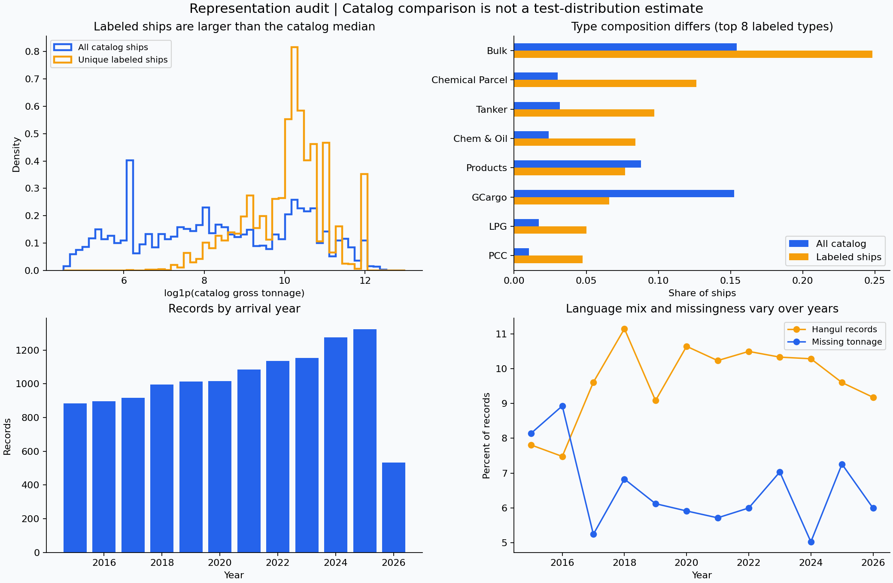

# 선박 매칭 데이터 종합 분석 — 8개 항목

이 리포트는 업로드한 공식 `train.csv`와 `vessel_catalog.csv`를 실제로 읽어 계산한 결과입니다. 설명의 의미는 다음과 같이 구분합니다.

- **확인된 사실:** 제공 데이터·대회 규정·실행 로그로 확인한 내용입니다.
- **분석상 가정:** 모델 설계에 필요한 해석이며 실제 운영 과정에서는 확인이 필요합니다.
- **제안·계획:** 아직 성능을 검증하지 않은 개선안입니다.

이번 추가 분석에서는 모델을 새로 학습하지 않았습니다. 앞서 학습한 LightGBM의 저장된 검증 예측을 다시 집계했으며, 신규 통계·품질 점검·대표성 그래프를 계산했습니다. 공개되지 않은 테스트 데이터는 읽거나 모델 선택에 사용하지 않았습니다.

## 1. 데이터 구조와 과제 정의

### 무엇을 예측하는가

**확인:** 입출항 신고 기록 한 행을 입력받아 카탈로그에서 같은 선박의 `vessel_id` 하나를 선택합니다. 학습 정답 컬럼은 `target_vessel_id`입니다. 카탈로그 밖의 선박을 별도 미등록 클래스로 출력하는 과제는 아닙니다.

적절한 과제는 **개체 매칭과 후보 순위화**입니다. 예를 들어 이름이 비슷한 후보를 여러 척 찾고, 이름·톤수·선종 등을 함께 비교해 가장 유력한 ID를 선택합니다. 후보 쌍을 학습할 때는 “같은 선박인가?”라는 이진 분류 문제로 표현할 수 있습니다. 최종 출력은 여전히 선박 ID 하나입니다.

| 파일 | 크기 | 한 행의 의미 |
|---|---:|---|
| `train.csv` | 12,222행 × 9열 | 정답 선박이 연결된 입출항 기록 |
| `vessel_catalog.csv` | 78,595행 × 8열 | 표준 선박 ID 하나의 제원 |
| `sample_submission.csv` | 3,000행 × 2열 | 제출 형식 예시; 실제 테스트 입력이나 전체 규모의 증거가 아님 |

관측 단위는 선박 자체가 아니라 **입출항 기록**입니다. 같은 선박이 여러 번 등장하므로 행들이 통계적으로 완전히 독립적이지 않습니다. 대회에서 요구하는 “행 독립 예측”은 다른 테스트 행을 참고하지 말라는 실행 규칙이며, 통계적 표본 독립성과는 다른 개념입니다.

### 변수 역할과 자료형

| 학습 컬럼 | 읽힌 자료형 | 역할 |
|---|---|---|
| `sample_id` | object, 문자열 | 입력 행 식별자·출력 순서 유지용 |
| `vessel_name` | object | 핵심 이름 입력 |
| `call_sign` | object | 선박 재식별에 쓸 수 있는 호출부호 키 |
| `gross_tonnage` | float64 | 총톤수 입력; 결측 때문에 실수형으로 읽힘 |
| `international_gross_tonnage` | float64 | 국제총톤수 입력 |
| `flag_name` | object | 국적·선적국 표기 |
| `vessel_type` | object | 선종 표기 |
| `arrival_year` | int64 | 2015–2026년의 입항 연도; 상세 날짜는 없음 |
| `target_vessel_id` | object | 학습 정답 |

카탈로그의 `vessel_id`는 조회 키, `vessel_name`·`vessel_type`·`unit`·`flag_name`은 문자열, `size`·`deadweight_tonnage`·`gross_tonnage`는 float64입니다.

**예측 시점 — 대회에서 확인된 조건:** 평가 서버가 기록을 전달하는 시점에 해당 행의 입력값, 공식 카탈로그, 공식 학습 데이터로 만든 고정 자산을 사용할 수 있습니다. 다른 테스트 행의 빈도·평균·투표·누적 별칭은 사용할 수 없습니다.

**운영상 가정:** 실제 서비스에서도 그 시점에 입력 이름·톤수·선종·국적을 확인할 수 있다고 가정합니다. 신고 접수 직후 예측하는지, 사후 정비 단계에서 예측하는지, 일부 제원이 나중에 수정되는지는 자료만으로 확인할 수 없습니다. 이 부분은 실제 서비스 설계 전에 확인할 사항이며 현재 대회 분석을 막지는 않습니다.

제약은 공식 두 파일만으로 추가 학습·검증, 추론 중 인터넷 불가, Python 추론 20분, RAM 26GB, 제출 규격 준수입니다. 외부 선박 DB·정답 매핑표를 사용하지 않습니다.

## 2. 데이터 품질

### 변수별 결측과 고유값

고유값 수는 결측을 제외한 값입니다.

**학습 데이터**

| 컬럼 | 고유값 | 결측 수 | 결측률 |
|---|---:|---:|---:|
| sample_id | 12,222 | 0 | 0% |
| vessel_name | 5,857 | 0 | 0% |
| call_sign | 5,851 | 0 | 0% |
| gross_tonnage | 4,582 | 793 | 6.49% |
| international_gross_tonnage | 4,572 | 793 | 6.49% |
| flag_name | 76 | 2,015 | 16.49% |
| vessel_type | 19 | 0 | 0% |
| arrival_year | 12 | 0 | 0% |
| target_vessel_id | 5,851 | 0 | 0% |

**카탈로그**

| 컬럼 | 고유값 | 결측 수 | 결측률 |
|---|---:|---:|---:|
| vessel_id | 78,595 | 0 | 0% |
| vessel_type | 138 | 0 | 0% |
| vessel_name | 78,594 | 0 | 0% |
| size | 24,147 | 6,563 | 8.35% |
| unit | 17 | 1 | 0.0013% |
| deadweight_tonnage | 27,220 | 5,592 | 7.11% |
| gross_tonnage | 17,577 | 214 | 0.27% |
| flag_name | 195 | 0 | 0% |

두 입력 톤수의 결측은 항상 함께 발생합니다. 한글 기록의 톤수 결측률은 0%, 비한글은 7.19%입니다. 국적 결측률도 각각 9.74%, 17.22%로 다릅니다. 수집·표기 경로의 차이가 가능한 원인이지만, 결측 생성 원인을 확정할 수는 없습니다.

### 중복과 키 무결성

- 전체 컬럼을 비교한 완전 중복 행은 두 파일 모두 **0행**입니다. 다만 고유한 `sample_id`가 중복된 입력을 가릴 수 있습니다.
- 학습에서 `sample_id`와 정답을 빼고 비교하면 중복 입력은 **1,000행**입니다. 동일 입력 그룹의 정답 충돌은 없습니다.
- 선박명과 두 톤수만 기준으로 하면 중복은 **6,103행**입니다. 실제 반복 입출항일 수 있어 일괄 삭제하지 않습니다.
- 학습의 모든 정답이 카탈로그에 있으며, 행 ID와 카탈로그 ID는 고유합니다.
- 카탈로그 이름은 정규화 후 **311개 그룹에서 중복**됩니다. 중복 초과 행은 312개이고 한 이름에 최대 3척이 대응합니다. 정확한 이름 일치만으로 항상 선박을 확정할 수 없습니다.

### 자료형·단위·값의 범위

원본 CSV 문자열도 다시 읽어 확인했습니다. 지정된 수치 컬럼에서 비어 있지 않은 값의 숫자 변환 실패, 무한대, 0 이하 값은 **0개**입니다. 연도는 모두 정수이고 상수 컬럼은 없습니다. 이것은 형식 검사 결과이며 모든 값의 실제 정확성을 보증하지는 않습니다.

`size`의 단위는 DWT, TEU, Cars, Passengers, LOA 등 17개입니다. 같은 숫자라도 화물중량·컨테이너 수·승객 수·길이처럼 의미가 다르므로 함께 평균을 내거나 동일 임계값으로 이상치를 판단하지 않습니다. 총톤수와 재화중량톤수도 같은 물리량이 아닙니다.

추가 확인 사항은 `unit='DWT'`이고 두 값이 관측된 49,297행 중 **1행에서 `size`와 `deadweight_tonnage`가 다르다**는 점입니다. `VESSEL_05608`은 각각 10,942와 12,922입니다. 갱신 시점이나 정의 차이일 수 있어 오류로 확정하지 않고, 해당 두 컬럼을 함께 사용할 경우 검토 대상으로 표시합니다. 초기 베이스라인은 `size`를 제외할 수 있습니다.

### 이상치

학습 총톤수의 중앙값은 27,658, 최대값은 174,407, 왜도는 2.326, 초과첨도는 5.745입니다. 큰 선박 때문에 오른쪽 꼬리가 길어지는 분포입니다.

`Q3+1.5×IQR=88,231`을 넘는 값은 640행입니다. 정상 대형 선박도 포함될 수 있으므로 삭제 기준으로 쓰지 않습니다. `log1p` 후 MAD 기준에서는 총톤수 23행이 표시됩니다. 두 기준은 원인 검토용이며, 선종·단위·정답 제원과 함께 살펴봐야 합니다. 원래 자료는 보존하고 정제 규칙은 학습 폴드에서 정합니다.

## 3. 타깃과 변수 탐색

### 타깃 분포

정답 선박은 5,851척이며 한 척당 기록은 1–4개입니다.

| 한 선박의 기록 수 | 선박 수 |
|---:|---:|
| 1 | 3,173 |
| 2 | 628 |
| 3 | 407 |
| 4 | 1,643 |

전체 정답 선박의 **54.23%가 한 번만 등장**합니다. 특정 다수 클래스가 압도한다기보다 클래스 수가 많고 각 클래스의 관측이 부족한 문제입니다. 일반적인 다중 클래스 분류나 SMOTE보다 후보 쌍 학습이 적합합니다. 학습에 있는 ID는 전체 카탈로그의 7.44%뿐이므로 학습 ID만 출력하는 모델은 나머지 선박을 선택할 수 없습니다.

한글 기록은 1,191행(9.74%)·382척입니다. 공식 점수의 70%를 차지하므로 전체 행 정확도만으로 모델을 선택하면 목표와 어긋날 수 있습니다.

### 분포와 정답의 관계

| 측정값 | 실측 결과 | 의미 |
|---|---:|---|
| 정답 카탈로그 이름과 정규화 후 일치 | 58.39% | 이름 정규화만으로는 해결되지 않는 표기 차이가 있음 |
| 두 톤수 중 하나가 정답 카탈로그 총톤수와 정확히 일치 | 6,136행, 전체의 50.20% | 정확 일치 외에 오차를 허용한 비교가 필요 |
| 두 입력 톤수 Pearson 상관계수 | 0.999981 | 대부분 중복 정보지만 항상 동일하지는 않음 |
| 두 입력 톤수 Spearman 상관계수 | 0.999919 | 순위 관계도 매우 비슷함 |
| 국제총톤수만 정답과 일치 | 123행 | 국제총톤수 경로를 무조건 제거하면 손실 |
| 일반 총톤수만 정답과 일치 | 1행 | 반대 경우도 존재 |

두 톤수만 넣은 선형 모델의 VIF는 약 26,500입니다. VIF는 변수끼리 얼마나 중복 설명하는지를 나타내며, 이 수치는 전체 특징 행렬의 VIF가 아닙니다. 선형 모델에서는 대표 톤수, 두 값의 차이, 후보에 대한 상대 오차로 바꾸고 정규화를 적용하는 것이 좋습니다. 트리 모델은 두 경로를 유지한 뒤 제거 실험으로 판단할 수 있습니다.

국적과 선종은 입력의 한글 분류와 카탈로그의 영문 분류가 달라 문자열 단순 일치가 적합하지 않습니다. 학습 폴드에서 대응 확률을 추정하거나 양쪽 범주 조합을 사용합니다.

`target_vessel_id`는 이름표이므로 숫자로 변환해 상관계수를 구하지 않습니다. 후보 쌍이 맞는지, 정답이 후보 목록에 들어왔는지, 최종 1위로 선택됐는지로 관계를 평가합니다. 위의 이름·제원 관계는 관찰된 연관성이며 원인과 결과를 증명하지 않습니다.

그래프 파일은 `output/eda_overview.png`, `output/tonnage_distributions.png`, `output/correlation_and_year.png`입니다.

## 4. 데이터 누수와 분할 전략

### 무엇이 누수가 될 수 있는가

1. **정답으로 만든 사전:** 호출부호·이름→ID 매핑과 선종·국적 대응 통계를 전체 데이터로 만든 뒤 분할하면 검증 정답이 들어갑니다. 분할 후 학습 폴드만 사용합니다.
2. **반복 관측:** 같은 선박·같은 입력이 양쪽에 있으면 조회 능력이 좋은 점수로 나타납니다. 기존 선박 재등장 시나리오에는 의미가 있지만 새 선박 일반화로 해석하면 안 됩니다.
3. **예측 이후 정보:** 컬럼명만으로 사후 수정 여부를 확인할 수 없습니다. `target_vessel_id`는 정답이므로 입력에서 제외하고, 실제 서비스에서는 나머지 필드의 생성·수정 시점을 확인합니다. 연도 자체가 자동으로 누수인 것은 아닙니다.
4. **전처리의 전체 데이터 학습:** 중앙값·스케일·인코딩·특성 선택을 검증까지 포함해 학습하지 않습니다.
5. **검증 후보에 정답 삽입:** 학습 쌍에는 양성을 추가할 수 있지만 검증에서 정답을 강제 삽입하면 검색 실패를 숨깁니다.
6. **테스트 간 정보 공유:** 테스트 호출부호·이름별 평균, 투표, 빈도, 누적 별칭, 순위 보정은 규칙 위반입니다. 같은 입력 한 행에 대한 후보들의 순위를 비교하는 것은 허용된 처리입니다.

### 권장 분할

| 검증 목적 | 분할 방법 | 확인할 것 |
|---|---|---|
| 새 선박 식별 | `StratifiedGroupKFold`, 그룹=`target_vessel_id`, 층화=한글 여부 | 학습·검증 선박 불겹침, 폴드별 한글 선박 수 |
| 기존 선박 재등장 | 별도 행 보류; 기존/신규 호출부호 구분 | 단순 조회가 기여하는 범위 |
| 미래 운영 | 연도순 학습→이후 연도 검증 | 기준연도 이후 정답·별칭을 과거 예측에 쓰지 않기 |

예를 들어 2015–2023년 학습은 9,091행, 2024–2026년 검증은 3,131행이고, 뒤 구간의 56.12%는 앞 구간에서 본 선박입니다. 이것은 **분할 크기를 계산한 결과이며 시간 검증 모델을 학습했다는 의미는 아닙니다.**

일·월 정보가 없고 미래 기간을 집계한 타깃도 아니므로 현재 구조에서 Purged Walk-Forward를 무조건 적용할 이유는 없습니다. 미래 기간 특징을 추가할 때 그 정의에 맞춰 다시 판단합니다.

**최종 테스트 보호:** 비공개 테스트는 접근하지 않았습니다. 현재 공개 train 전체는 이미 EDA와 제출 모델 학습에 사용했으므로, 완전히 손대지 않은 로컬 최종 테스트가 있다고 주장할 수 없습니다. 이후 비교 실험은 분할을 고정하고 매번 학습 폴드부터 새로 학습합니다. 이전에 살펴본 보류 세트를 최종 독립 테스트라고 부르지 않습니다. 모델 선택에는 교차검증을 사용하고 비공개 최종 평가의 정답은 사용하지 않습니다. Public 점수를 반복 확인한 경우 그 점수 역시 완전히 독립적인 최종 성능으로 해석하지 않습니다.

## 5. 대표성과 편향

### 확인된 차이

비교 단위를 맞추기 위해 반복 입출항 행을 제거한 **고유 정답 선박 5,851척**의 카탈로그 제원을 전체 카탈로그와 비교했습니다.

| 항목 | 학습에 등장한 고유 선박 | 전체 카탈로그 |
|---|---:|---:|
| 선박 수 | 5,851 | 78,595 |
| 총톤수 중앙값 | 29,354 | 4,270 |
| 선종 종류 | 47 | 138 |
| 국적·선적국 종류 | 84 | 195 |

학습 정답이 전혀 없는 카탈로그 선종은 91개, 국적은 111개입니다. 학습 정답이 있는 범주 중에도 선박이 1–5척뿐인 선종은 22개, 국적은 34개입니다. 이는 범용화에 대한 불확실성을 보여주지만, 카탈로그는 후보 목록이므로 **카탈로그 비율이 실제 테스트 기록의 비율이라고 가정해서는 안 됩니다.** 이 차이를 근거로 테스트 분포를 추정해 예측을 보정하지 않습니다.

입력 선종에도 여객선·냉동/냉장선은 각 1행, 철강재 운반선·석탄운반선은 각 2행밖에 없습니다. 이런 집단에서 나온 점수는 표본이 너무 적어 안정적인 성능 추정이 어렵습니다.

### 기간 차이

| 연도 | 기록 수 | 한글 기록 수 | 톤수 결측률 |
|---:|---:|---:|---:|
| 2015 | 884 | 69 | 8.14% |
| 2016 | 896 | 67 | 8.93% |
| 2023 | 1,152 | 119 | 7.03% |
| 2024 | 1,274 | 131 | 5.02% |
| 2025 | 1,323 | 127 | 7.26% |
| 2026 | 534 | 49 | 5.99% |

연도별 표본 수와 언어·결측 비율이 다릅니다. 2026년 표본 수 감소가 실제 운항 감소인지, 수집 기간 일부만 포함됐는지, 표본 추출 때문인지는 알 수 없습니다. 연도 전체를 대표한다고 가정하지 않습니다.

### 데이터만으로 확인할 수 없는 것

- 항만·항로·지역 컬럼이 없어 지역별 대표성을 검증할 수 없습니다. **선적국은 운항 지역이 아닙니다.**
- 공식 제공 자료라는 점 외에 원시 수집 체계, 전체 모집단, 표본 추출 비율, 정확한 관측 종료일, 제원 갱신 이력은 확인하지 못했습니다.
- 테스트의 한글 비율, 기존 선박 비율, 결측 분포, 실제 오류 크기는 알 수 없습니다.
- 상용 운영에서 잘못 연결한 비용과 사람이 다시 확인하는 비용의 차이는 주어지지 않았습니다.



## 6. 전처리와 특성 설계

### 변수별 권장 처리

| 변수 | 처리 | 이유 |
|---|---|---|
| 선박명 | 원본 보존 + Unicode·대소문자·공백 정규화 + 문자·자모·발음 유사도 | 표기 차이 대응; 숫자와 구분 접미어는 무조건 삭제하지 않음 |
| 호출부호 | 학습 폴드에서 모호하지 않은 ID 조회; 미등록 시 일반 매칭 | 기존 선박 재식별; 임의의 숫자 순서로 인코딩하지 않음 |
| 두 톤수 | 원본 결측 유지, 후보별 상대 오차, 결측 표시 | 평균 대체로 가짜 일치를 만들지 않음 |
| 수치 비교 특징 | 트리는 결측 직접 처리; 선형 모델은 학습 중앙값 대체 + RobustScaler | 모델별 필요한 전처리를 구분 |
| 선종·국적 | 결측 범주, 희귀 범주 묶음, One-hot 또는 모델 범주 기능 | 명목형 범주에 임의의 크기 순서를 부여하지 않음 |
| `size`·`unit` | 초기에는 size 제외; 확장 시 단위별 처리 | 다른 물리량 혼합과 1건의 불일치 회피 |
| 재화중량톤수 | 필요 시 log1p와 선종 상호작용; GT 대체에 직접 사용하지 않음 | 총톤수와 다른 제원 |
| 연도 | 우선 검증 축으로 사용; 특징 추가는 제거 실험과 시간 검증으로 판단 | 시점의 우연한 연관성에 의존할 위험 |
| sample_id·ID 숫자 부분 | 예측 특징에서 제외 | 식별·정렬용 정보이며 크기에 의미가 없음 |
| target_vessel_id | 라벨로만 사용 | 정답 누수 방지 |

이상치 표시를 만들더라도 원본을 보존합니다. 모델 입력에 쓸 중앙값·스케일·희귀 범주 기준·이상치 임계값·특성 선택은 학습 폴드에서만 결정합니다. 공식 카탈로그 전체를 후보 검색 대상으로 쓰는 것은 대회 조건에 맞지만, 검증 기록의 정답으로 만든 사전은 사용할 수 없습니다.

### 유용한 파생변수

1. **이름 유사도:** 정규화 문자열·한글 자모·로마자·발음 키를 각각 비교합니다.
2. **숫자 구분:** 선박명 숫자 일치, 숫자 누락, 공통 접두어를 제외한 이름 유사도를 만듭니다.
3. **제원 상대 오차:** `abs(query−candidate)/max(query,candidate)`를 두 톤수에 각각 계산합니다.
4. **톤수 불일치:** 입력 GT와 IGT 사이의 상대 차이와 어느 값이 후보와 더 잘 맞는지를 보존합니다.
5. **결측 상호작용:** 톤수가 없을 때 이름·선종 증거의 중요도를 표현합니다.
6. **분류 체계 연결:** 입력 선종×카탈로그 선종, 입력 국적×카탈로그 국적 조합을 사용합니다.
7. **행 내부의 모호성:** 최고 후보와 차점의 점수 차이를 수동 확인 우선순위에 활용합니다. 다른 테스트 행과 비교하지 않습니다.

### 재현 가능한 Pipeline

이미 작성·실행한 `pair_pipeline.py`에는 다음 흐름이 있습니다.

```text
입력 한 행 + 카탈로그 후보
    → PairFeatureBuilder: 이름·제원·결측·범주 조합
    → ColumnTransformer
        수치: 학습 중앙값 대체 + 결측 표시 + RobustScaler
        범주: 결측 범주 + 희귀 범주 One-hot
    → LogisticRegression
    → 해당 입력 행의 후보 중 최고 점수 ID 선택
```

```python
from sklearn.model_selection import StratifiedGroupKFold
from analysis.pair_pipeline import PairRetriever, make_pipeline, choose_ids

language = train['vessel_name'].str.contains('[가-힣]', na=False).astype(int)
cv = StratifiedGroupKFold(n_splits=5, shuffle=True, random_state=42)
retriever = PairRetriever(catalog)  # 공개 카탈로그만 사용

for fit_idx, val_idx in cv.split(train, y=language, groups=train['target_vessel_id']):
    fit_df, val_df = train.iloc[fit_idx], train.iloc[val_idx]
    X, y, _ = retriever.pairs(fit_df, training=True)
    V, _, metadata = retriever.pairs(val_df, training=False)
    pipeline = make_pipeline()
    pipeline.fit(X, y)  # imputer·scaler·encoder도 여기에서만 학습
    scores = pipeline.predict_proba(V)[:, 1]
    predicted_ids = choose_ids(metadata, scores)
    # val_df.sample_id 순서로 정렬한 뒤 언어별 정확도·가중 점수 계산
```

이 코드는 5-fold 실행 **예시**이며 이번에 전체 5-fold를 돌렸다는 뜻은 아닙니다. 전체 데이터에서 후보 쌍을 생성하면 메모리가 커질 수 있어 실제 실험에는 배치 생성·어려운 음성 수 제한을 적용합니다. 언어별 가중치와 행별 후보 수 정규화 예제도 실행 파일에 있습니다.

## 7. 모델과 평가 계획

### 비교할 모델

| 구분 | 구성 | 장점·한계 | 상태 |
|---|---|---|---|
| 단순 기준 | 학습 호출부호 조회 → 정규화 이름 일치 → 이름·톤수 고정 규칙 | 이해하기 쉽고 빠름; 음역과 모호한 후보에 한계 | 이번 비교 점수는 미측정 |
| 비교 1 | 후보 쌍 특징 + LogisticRegression | 특징의 방향을 살펴보기 쉬움; 복잡한 상호작용은 별도 설계 필요 | 300행 학습·80행 검증으로 실행 검사만 수행 |
| 비교 2 | 같은 후보와 특징 + LightGBM | 이름·톤수·결측의 비선형 조합 처리 | 앞선 실측 결과 있음 |
| 비교 3 | 같은 후보 + CatBoost | 범주형 교차와 결측 처리 비교에 유용 | 미학습, 평가 계획 |

가능한 한 같은 후보 검색기·분할·입력 특징으로 비교해야 모델 자체의 효과를 판단할 수 있습니다. 서로 다른 후보 검색기를 쓰면 검색 성능 차이까지 섞입니다. 학습 기준 모델과 조회 경로의 기여도도 분리합니다.

### 무엇으로 평가할 것인가

- **공식 가중 Top-1 정확도:** 대회 모델 선택의 우선 지표입니다.
- **한글·비한글 각각의 정확도와 오류 수:** 작은 한글 그룹의 문제가 전체 정확도에 가려지지 않게 합니다.
- **후보 검색 재현율:** 정답이 후보 목록에 들어오는 비율입니다. 후보 개수가 가변이면 가변 후보 재현율로 부르고, 후보 수를 고정했을 때만 `Recall@K`로 표기합니다.
- **Top-3·Top-5 정확도와 MRR:** 정답이 추천 목록의 몇 번째에 오는지 평가합니다. 현장 추천에 유용하지만 이번에는 계산하지 않았습니다.
- **선박별 평균 정확도:** 각 선박의 정확도를 먼저 계산하고 선박마다 같은 비중으로 평균합니다. 반복 기록의 영향 확인용이며 공식 지표와 다릅니다.
- **집단별 성능:** 신규/기존 호출부호, 결측 유무, 선종, 연도별 오류를 표본 수와 함께 봅니다.
- **실행 품질:** 데이터 로딩·인덱스 생성·추론·저장 전체 시간, 최대 메모리, 행 순서·부분집합·단독 입력의 결과 일치입니다.

후보 쌍의 음성 비율은 후보 수에 따라 달라지므로 후보 쌍 정확도나 ROC-AUC만으로 최종 선박 선택 성능을 판단하지 않습니다. 고정된 후보 검색기 안에서 PR-AUC·log loss를 보조 지표로 사용할 수는 있지만, 점수 보정과 후보 Top-1의 관계를 따로 확인해야 합니다.

잘못 연결한 선박의 비용이 큰 실제 서비스라면 확신이 낮은 경우 사람에게 후보 목록을 제시하는 정책을 검토할 수 있습니다. 비용 행렬·확률 보정·임계값은 아직 정해지지 않았습니다. 대회 제출은 모든 행에 ID 하나를 요구하므로 임의의 미확정 값은 출력하지 않습니다.

### 실제로 측정한 기존 LightGBM 결과

아래 값은 앞서 학습한 모델의 저장된 검증 예측을 이번에 다시 집계한 결과입니다. 새로운 교차검증이나 공식 서버 점수가 아닙니다.

| 지표 | 새 선박 보류 | 기존·새 선박 혼합 행 보류 |
|---|---:|---:|
| 기록 수 / 선박 수 | 2,400 / 1,171 | 1,965 / 1,642 |
| 한글 정확도 | 92.68% | 97.97% |
| 비한글 정확도 | 99.95% | 99.83% |
| 공식 산식 가중 점수 | **94.86%** | **98.53%** |
| 단순 전체 행 정확도 | 99.33% | 99.64% |
| 선박별 평균 정확도 | 99.47% | 99.57% |
| 오분류 행 / 오류가 있는 선박 | 16 / 7 | 7 / 7 |

새 선박 보류의 한글 표본은 205행·71척이고, 혼합 행 보류의 70.89%는 학습에서 본 선박입니다. 따라서 98.53%를 새 선박 성능으로 해석하면 안 됩니다. 전체 행 정확도 99.33%가 좋아 보여도 공식 산식 점수는 94.86%라는 차이도 중요합니다.

새 선박 보류에서 후보 검색 재현율은 한글 99.51%, 비한글 99.95%였습니다. 한글은 후보에 정답이 들어온 뒤 잘못 고르는 경우의 개선 여지가 있습니다. 같은 보류 세트의 톤수 결측 175행은 모두 맞았지만, 원래 한글 기록에는 톤수 결측이 없으므로 “톤수 결측에 전반적으로 강하다”거나 “한글 결측에도 강하다”는 결론은 내릴 수 없습니다.

이후 모델 비교는 동일한 5-fold의 전체 OOF 예측을 모아 공식 산식으로 계산하고, 선박 단위 bootstrap으로 점수 변동을 살펴보는 것을 권합니다. 5-fold와 신뢰구간은 아직 실행하지 않았습니다.

## 8. 최종 정리

### 핵심 발견 5개

1. **분류할 ID를 외우는 것만으로는 부족합니다.** 학습 정답은 카탈로그의 7.44%이며, 54.23%의 정답 선박은 한 번만 등장합니다. 후보 매칭 구조가 필요합니다.
2. **한글 기록이 평가의 중심입니다.** 행 비율은 9.74%이지만 점수 비중은 70%이고, 결측 패턴도 비한글과 다릅니다.
3. **거의 같은 두 톤수에도 보완 정보가 있습니다.** 상관계수는 0.999981이지만 국제총톤수만 정답에 일치하는 123행을 보존해야 합니다.
4. **조회 누수와 동명 선박을 함께 다뤄야 합니다.** 학습 호출부호는 ID를 구분하지만 사전을 분할 전에 만들면 누수입니다. 카탈로그의 정규화 이름 중복 그룹도 311개입니다.
5. **검증 조건과 대표성에 따라 점수 해석이 달라집니다.** 새 선박 가중 점수는 94.86%, 기존 선박이 섞인 점수는 98.53%입니다. 학습의 선박 크기·선종 분포는 카탈로그와 다르며 실제 테스트 분포는 알 수 없습니다.

### 다음 학습 전에 해결할 문제

이미 베이스라인은 학습했으므로 아래 목록은 다음 비교·개선 실험 전에 적용할 사항입니다. P0는 먼저 해결, P1은 성능 비교 전 점검, P2는 확장 시 점검입니다.

| 문제 | 근거 | 영향 | 해결 방법 | 우선순위 |
|---|---|---|---|---|
| 분할 전 정답 사전·통계 생성 위험 | 호출부호가 학습에서 ID와 일대일 | 검증 성능 과대평가 | 선박 그룹 분할 후 폴드별 사전·통계·전처리 생성 | P0 |
| 테스트 행 간 정보 공유 위험 | 대회 행 독립 규칙 | 규칙 위반·재현성 실패 | 고정 학습 자산만 조회, 순서·부분집합·단독 입력 검사 | P0 |
| 관찰한 보류 세트를 최종 테스트로 오해 | 기존 보류 결과를 이미 분석함 | 일반화 성능에 과도한 확신 | 모델 선택용 검증으로 명시, 최종 비공개 평가와 분리 | P0 |
| 한글 표본 희소성과 높은 평가 비중 | 1,191행·382척, 점수 70% | 전체 정확도 기준 모델 선택 실패 | 언어 층화 그룹 검증, 언어별 지표·학습 가중치 | P1 |
| 후보 누락·동명 선박 | 이름 중복 311그룹 | 순위 모델이 정답을 선택할 수 없음 | 검색 재현율과 후보 순위 성능을 나눠 평가 | P1 |
| 톤수 결측·높은 공선성 | 793행 동시 결측, 높은 VIF | 잘못된 대체·계수 불안정 | 상대 오차·대표값·불일치·결측 표시 | P1 |
| 소수·미관측 선종과 국적 | 정답 없는 선종 91개·국적 111개 | 적용 범위 밖 성능 불확실 | 표본 수 동반 집단 성능, 미등록 범주 처리 | P1 |
| 혼합 단위·DWT 불일치 1건 | size 17단위, 1건 제원 차이 | 단위가 다른 비교·잘못된 대체 | size 초기 제외, 필요 시 단위별 검토 | P2 |

### 권장 전처리 및 검증 전략

이름의 여러 표현과 두 톤수의 후보별 오차를 만들고, 결측과 원래 숫자 정보를 보존합니다. 호출부호·별칭 사전과 범주 대응 정보는 학습 폴드에서만 만듭니다. 고유 ID의 숫자 부분과 정답 컬럼은 예측 특징에서 제외합니다. 주 검증은 한글 여부를 고려한 선박 그룹 5-fold, 보조 검증은 기존 선박 재등장과 연도순 분할입니다. 후보 검색과 최종 선택을 구분하고 언어별·선박별·결측별 결과를 함께 봅니다.

### 다음에 실행할 작업 3개

1. **분할·평가 코드를 고정합니다.** 한글 층화 선박 그룹 5-fold, 누수 방지, 공식 산식·후보 재현율·집단별 결과 저장을 하나의 실행 흐름으로 만듭니다.
2. **같은 후보에서 모델을 비교합니다.** 단순 규칙, LogisticRegression, LightGBM, CatBoost를 비교하고, 한글 발음·숫자·접두어·두 톤수의 기여도를 제거 실험으로 확인합니다.
3. **선택 모델의 제출 조건을 검증합니다.** 전체 공개 학습 데이터로 다시 학습한 뒤 오프라인·읽기 전용 입력·행 독립성·서버 규격을 검사합니다. 실서비스를 검토할 경우 이 단계에서 입력 필드의 이용 가능 시점과 오연결 비용을 확인합니다.

## 재현 코드와 산출물

프로젝트 루트에서 다음을 실행합니다. 분석 패키지만 받은 경우 `data/`에 원래 제공된 train과 catalog를 두면 됩니다.

```bash
python -m pip install -r analysis/requirements-analysis.txt
python analysis/eda.py --data-dir data --output-dir analysis/output
python analysis/comprehensive_analysis.py --data-dir data --reports-dir reports --output-dir analysis/output
python analysis/pair_pipeline.py --smoke --data-dir data --output-dir analysis/output
```

- `eda.py`: 기본 스키마·결측·분포·상관성과 그래프를 재계산합니다.
- `comprehensive_analysis.py`: 자료형 이상, 범주·기간 대표성과 기존 검증 예측의 진단 지표를 재계산합니다. 기존 예측 CSV가 없으면 모델 진단만 `available=false`로 표시하며, 없는 성능을 생성하지 않습니다.
- `pair_pipeline.py`: 학습 300행·검증 80행의 실행 확인용 예제입니다. 검증 후보에 정답을 강제 추가하지 않고, 단독·순서 변경·결측·미등록 범주 처리를 검사합니다.
- `output/train_integrity.csv`, `catalog_integrity.csv`: 변수별 품질 표입니다.
- `output/*_representation.csv`, `query_*_groups.csv`: 선종·국적·연도별 표본 수와 분포입니다.
- `output/*holdout_by_*.csv`: 앞선 모델의 집단별 실측입니다.
- `output/comprehensive_summary.json`: 이번 추가 분석 결과와 입력 파일 SHA-256입니다.

그래프와 통계는 로컬 Python 3.12에서 생성했습니다. 실제 패키지 버전은 `output/environment.json`에 있습니다. 공식 서버 실행·비공개 성능·5-fold 모델 비교는 이번 보고서에서 수행했다고 주장하지 않습니다.
