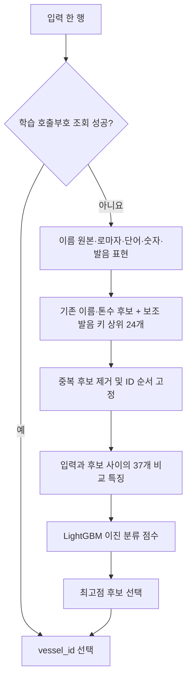
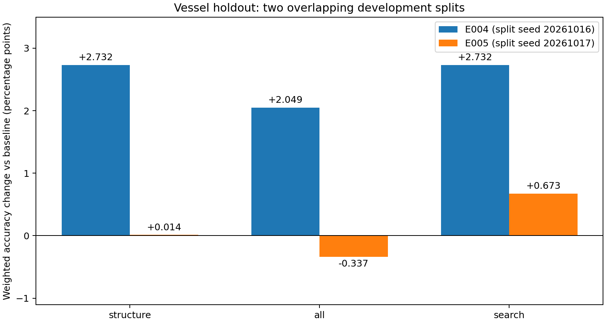

# 선박명 처리 개선 실험 결과

공식 train과 카탈로그만 사용한 로컬 개발 검증이다. 기존 보류 오답을 확인한 뒤 개선했으므로 독립 최종 테스트 결과가 아니다. 두 분할은 일부 관측이 겹쳐 2-fold OOF라고 부르지 않는다.

## 변경 내용

- baseline: 기존 23개 비교 특징과 후보 검색.
- structure: 단어 경계·숫자열 보존, 숫자 충돌·개수 차이, 카탈로그 IDF를 이용한 단어별 비교 등 8개 특징 추가(31개).
- all: structure에 모음을 보존한 가중 발음 편집거리, 단어·끝 단어·공통 가장자리 제외 비교 등 6개 추가(37개).
- search: all에 완화된 발음 키 상위 24개 후보를 합집합으로 추가. 최종 후보 수가 늘어나므로 같은 검색 예산 비교가 아니다.

발음 처리는 Unidecode와 고정 규칙·가중 편집거리이며 G2P·음성 인식·다국어 임베딩 모델이 아니다. PH→F, CK→K, QU→KW를 보조 표현에서 변환하며 원래 철자 특징은 보존한다. 일반 편집 비용 4, 모음 삽입·삭제 2, 모음 간/지정 유사 자음 교체 1을 사용한다. 비용과 공통 가장자리 기준 0.8은 이번 비교 전 고정한 가설이며 최적값이라는 근거는 없다.

## 같은 분할에서의 실측

| 실험·분할 | 구성 | 한글 정확도 | 비한글 정확도 | 가중 정확도 | 오류 | 예측 구간(초) |
|---|---|---:|---:|---:|---:|---:|
| E004·새 선박 | baseline | 92.683% | 99.954% | 94.864% | 16 | 16.52 |
| E004·새 선박 | structure | 96.585% | 99.954% | 97.596% | 8 | 21.84 |
| E004·새 선박 | all | 95.610% | 99.954% | 96.913% | 10 | 33.16 |
| E004·새 선박 | search | 96.585% | 99.954% | 97.596% | 8 | 52.33 |
| E004·혼합 | baseline | 97.970% | 99.830% | 98.528% | 7 | 3.58 |
| E004·혼합 | structure | 98.477% | 99.887% | 98.900% | 5 | 4.63 |
| E004·혼합 | all | 99.492% | 99.830% | 99.594% | 4 | 7.07 |
| E004·혼합 | search | 99.492% | 99.887% | 99.611% | 3 | 11.21 |
| E005·새 선박 | baseline | 95.673% | 99.819% | 96.917% | 13 | 15.99 |
| E005·새 선박 | structure | 95.673% | 99.864% | 96.930% | 12 | 20.79 |
| E005·새 선박 | all | 95.192% | 99.819% | 96.580% | 14 | 36.15 |
| E005·새 선박 | search | 96.635% | 99.819% | 97.590% | 11 | 51.18 |
| E005·혼합 | baseline | 100.000% | 99.943% | 99.983% | 1 | 3.38 |
| E005·혼합 | structure | 99.492% | 99.943% | 99.628% | 2 | 4.23 |
| E005·혼합 | all | 99.492% | 99.943% | 99.628% | 2 | 6.74 |
| E005·혼합 | search | 100.000% | 99.943% | 99.983% | 1 | 10.68 |

예측 구간에는 후보 검색·특징 계산·점수 계산·진단이 포함된다. CSV 로딩, 인덱스 생성, 결과 파일 저장은 제외한다. 공식 서버 속도가 아니다.

## 검증 조건과 후보 포함률

LightGBM 350개 트리, 학습률 0.05, leaves 31, min_child_samples 40, colsample_bytree 0.9, L2 2, 모델 시드 20261016을 고정했다. 학습 선박의 호출부호·별칭·범주 대응만 사용하며, 단어 빈도는 공식 카탈로그에서만 계산했다. 특징 비교 두 구성의 학습 후보 쌍 해시와 검증 후보 목록 해시를 확인했다.

| 실험 | 학습 행 | 새 선박 한글/비한글 | 혼합 한글/비한글 | 혼합의 기존 선박 비율 |
|---|---:|---|---|---:|
| E004 | 7857 | 205/2195 | 197/1768 | 70.89% |
| E005 | 7842 | 208/2211 | 197/1764 | 71.44% |

| 실험 | 구성 | 새 선박 한글 후보 포함률 | 비한글 후보 포함률 | 평균 후보 수 | 검색/선택 오류 |
|---|---|---:|---:|---:|---|
| E004 | baseline | 99.512% | 99.954% | 62.25 | 2/14 |
| E004 | structure | 99.512% | 99.954% | 62.25 | 2/6 |
| E004 | all | 99.512% | 99.954% | 62.25 | 2/8 |
| E004 | search | 100.000% | 99.954% | 80.65 | 1/7 |
| E005 | baseline | 99.519% | 99.955% | 63.00 | 2/11 |
| E005 | structure | 99.519% | 99.955% | 63.00 | 2/10 |
| E005 | all | 99.519% | 99.955% | 63.00 | 2/12 |
| E005 | search | 100.000% | 99.955% | 81.57 | 1/10 |

후보 수가 가변이므로 위 수치를 Recall@24 등 고정 K 지표로 해석하지 않는다. 호출부호 조회 행은 후보 수 평균에서 제외한다.

## 채택 판단

선정 규칙에 따른 구성: **search**. 두 분할의 새 선박 가중 정확도 단순 평균을 주 기준으로 사용했다. 이 평균은 독립 표본의 OOF 점수가 아니다.

| 구성 | 두 분할 새 선박 점수 평균 | 혼합 점수 평균 | 두 분할 모두 기준 대비 개선 |
|---|---:|---:|---|
| baseline | 95.891% | 99.255% | False |
| structure | 97.263% | 99.264% | True |
| all | 96.747% | 99.611% | False |
| search | 97.593% | 99.797% | True |

## 개선된 오류와 새 오류

| 실험 | 구성 | 기존 오류 수정 | 기존 정답의 새 오류 | 남은 기존 오류 |
|---|---|---:|---:|---:|
| E004 | structure | 8 | 0 | 8 |
| E004 | all | 12 | 6 | 4 |
| E004 | search | 14 | 6 | 2 |
| E005 | structure | 5 | 4 | 8 |
| E005 | all | 5 | 6 | 8 |
| E005 | search | 4 | 2 | 9 |

### 공개 train 보류의 대표 변화

| 실험 | 변화 | 입력 이름 | 정답 이름 | 기존 예측 이름 | search 예측 이름 | 행 수 |
|---|---|---|---|---|---|---:|
| E004 | 수정 | 모닝 컴포저 | Morning Composer | Morning Cello | Morning Composer | 4 |
| E004 | 수정 | 베마그레이스 | Vemagrace | ABC Sun | Vemagrace | 4 |
| E004 | 수정 | 씨에스 오션 | CS Ocean | CS Hana | CS Ocean | 4 |
| E004 | 새 오류 | 제2 오션파이오니어 | Ocean Pioneer No. 2 | Ocean Pioneer No. 2 | Lila Confidence | 4 |
| E004 | 새 오류 | 치셍 | Chih Sheng | Chih Sheng | Pin Seng | 2 |
| E005 | 수정 | 골든 그레이스 하나 | Golden Grace Hana | Golden Sunny Hana | Golden Grace Hana | 4 |
| E005 | 새 오류 | 치셍 | Chih Sheng | Chih Sheng | Pin Seng | 2 |

같은 선박의 여러 기록이 함께 수정되거나 틀린다. 예를 들어 E005의 수정 4행은 하나의 이름 그룹에서 발생했고, 새 오류 2행도 하나의 이름 그룹에 모였다. 개선을 여러 독립 선박에서 입증한 것으로 과장하지 않는다. 이름별 결과는 관측 사실이며 어떤 특징이 원인인지는 추가 제거 실험이 필요하다.

단어·발음 특징은 여러 개를 함께 추가했다. 어떤 단일 특징이 개선을 일으켰다고 단정하거나 feature importance를 인과적 기여도로 해석하지 않는다. search는 검색 후보와 학습 음성 구성이 함께 달라진 실험이다.

## 한계와 다음 단계

- 발음 규칙은 언어·고유명사의 실제 발음을 복원하지 않는다. 약칭과 이름 변경은 여전히 어렵다.
- 토큰 비교는 양방향 최고 유사도를 사용하므로 서로 다른 토큰이 같은 후보 토큰에 연결될 수 있다. 한영 붙여쓰기 차이는 전체 이름 특징으로 보완하지만 완전히 해결하지 못한다.
- 두 개발 분할은 모델 선택에 사용했다. 일반화 확인에는 선박 그룹 교차검증 또는 새 공식 평가가 필요하다.
- 한국어 표본 수가 작고 동일 선박의 반복 기록이 있다. 행 단위 정확도를 독립 선박 표본 수로 해석하지 않는다.
- 테스트 행의 빈도·다수결·누적 별칭을 사용하지 않는다. 모든 구성에서 전체/순서변경/단독/부분집합 예측 일치를 검사했다.
- 실험은 기존 Python 3.12 가상환경에서 실행했다. 공식 Python 3.11 평가 서버의 점수·전체 실행 시간은 미측정이다.

## 재현 및 근거

- 실행 코드: `experiments/name_ablation.py`, `model/name_processing.py`, `train.py`.
- 모든 실행 명령·코드/데이터/분할/모델 해시·환경·시간·행 독립성 결과: `project_log/experiments/E004.json`, `E005.json`.
- 원본 모델과 ZIP은 `/workspace/vessel_matching/`에 보존했다. 새 모델 배포 여부·ZIP 검사 결과는 별도 E006 기록을 따른다.

## 전체 학습·제출 파일 검사(E006)

- 최종 구성: search; 공식 학습 12,222행, 후보 쌍 445,948개.
- 전체 학습 시간: 137.11초(자산·인덱스·특징·학습·모델 저장 포함, CSV 로딩 제외).
- ZIP: 672,889바이트; 압축 해제 1,724,888바이트.
- ZIP SHA-256: `b8ca7cb433c617b9952efd705834fa1d88790d019888615716ebb379da85b002`.
- 깨끗한 압축 해제, 네트워크 차단, 입력 보존, 출력 형식/순서, 전체·순서변경·부분·단독·빈 입력 검사를 통과했다.
- 제출 파일: `/workspace/vessel_matching/name_improved_submission/submit.zip`. 원래 ZIP은 그대로 보존했다.

공개 train 12,222행 전체의 호출부호를 미등록 값으로 바꾸어 일반 매칭 경로의 실행 비용을 측정했다. **275.22초, 최대 RSS 453.8 MiB**였다. 새 프로세스 시작·라이브러리 import·CSV 로딩·인덱스·전처리·예측·CSV 저장을 포함하고 ZIP 해제·입력 준비는 제외한다. 원래 학습 별칭은 유지했다. 전체 학습 기록에 대한 비용 검사이므로 정확도 평가가 아니며, 비공개 테스트 규모와 공식 서버 시간은 확인하지 못했다.
