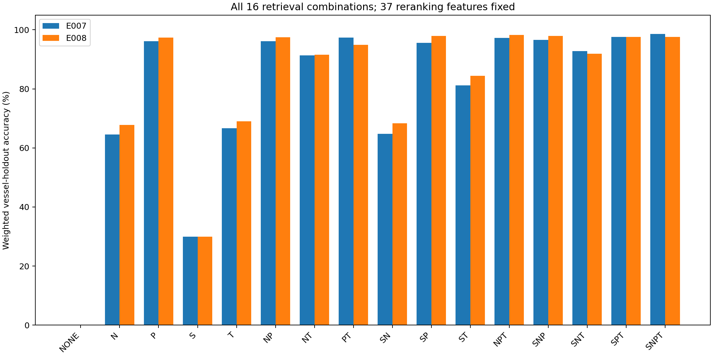

# 네 검색 방법의 모든 조합 실험

요청한 문자 n-gram 검색을 구현하고, 4개 검색 경로의 모든 부분집합 16개를 기존 두 개발 분할에서 평가했다. 총 32개 조합·분할 결과이며, 실제 학습은 비어 있지 않은 15개 조합 × 2분할 = 30개 모델이다. NONE 2건은 학습하지 않는 고정 기준선이다.

## 무엇을 켜고 껐는가

| 기호 | 검색 방법 | 고정한 구현 |
|---|---|---|
| S | 기존 문자열 | 비한글 정규화 이름 RapidFuzz 상위 24개. 기존 구현을 보존해 한글은 이 경로를 사용하지 않음 |
| N | 문자 n-gram | 로마자화한 카탈로그 이름의 문자 2~4gram TF-IDF·코사인, 한글 60개/비한글 24개; 양수 점수만 |
| P | 로마자·발음 | 한글 로마자 60개 + 기존 자음 키 60개; 모든 언어에 추가 발음 키 24개 |
| T | 톤수·제원 | 두 톤수별 근접 후보와 한글의 추정 선종별 근접 후보; 기존 설정 유지 |

**검색 경로의 조합 실험**이다. 최종 후보를 평가하는 37개 특징은 모든 조합에서 유지했다. 예를 들어 T를 꺼도 다른 경로로 찾은 후보와 입력의 톤수 차이는 분류기 특징으로 남는다. N에서도 한영 문자열을 비교할 수 있도록 로마자 변환을 공통 전처리로 사용하므로, P를 끈다는 것은 로마자·발음 유사도 검색 경로를 끈다는 뜻이다.

N의 어휘와 IDF는 공식 카탈로그 78,595행으로만 만들었다. 학습/검증/테스트 이름을 모아 fit하지 않는다. 각 입력 행은 고정된 희소 인덱스에 독립적으로 질의하며, 동점은 카탈로그 ID 순서로 결정한다.

예를 들어 OCEAN의 2글자 조각은 OC·CE·EA·AN이다. TF-IDF는 여러 선박에서 흔한 조각의 비중을 낮추고 드문 조각의 비중을 높이며, 2~4글자 조각을 함께 비교한다. 일부 철자가 달라도 나머지 조각으로 후보를 찾을 수 있지만, 이 방법 자체가 발음을 이해하거나 한글 음역의 원래 영문 철자를 복원하는 것은 아니다. 이번 카탈로그의 어휘는 89,536개 조각, 희소 행렬의 0이 아닌 항목은 1,869,600개였다.

## 공정한 비교 조건과 시간 해석

- 기존 분할·학습 행 순서·37개 특징·LightGBM 350개 트리와 모든 하이퍼파라미터를 유지했다.
- 각 조합은 자신의 검색 결과에서 음성 후보를 골라 별도로 학습했다. 정답 후보 주입은 학습에만 수행했다.
- 공통 기록–후보 쌍의 특징 계산만 재사용했다. 다른 조합의 후보를 해당 조합의 검색 결과로 포함하지 않았다.
- pure는 호출부호 조회와 학습 별칭을 꺼 검색 경로 자체를 비교한다. production은 고정된 학습 호출부호·별칭을 사용하는 실제 추론 조건이다.
- NONE과 검색 결과가 없는 행은 카탈로그 ID 정렬의 첫 ID로 처리한다. 빈 검색 건수도 기록한다. NONE의 production 점수에는 호출부호·별칭 효과가 들어갈 수 있다.
- 각 경로의 후보 예산은 고정했지만 합집합 크기는 달라진다. 이를 같은 총 후보 수의 비교나 Recall@K라고 부르지 않는다.
- 두 분할 작업을 동시에 실행했다. 학습 시간은 자원 경합 영향을 받으며, cached_evaluation_seconds는 검색·특징 계산을 제외한 재사용 평가 시간이다. 어느 것도 실제 제출 추론 시간으로 제시하지 않는다.
- 두 분할은 겹치는 개발 검증이며 2-fold OOF 또는 독립 최종 테스트가 아니다.

## 16개 조합 전체 결과

아래는 새 선박 pure 가중 정확도이며, 산식은 0.7×한글 정확도 + 0.3×비한글 정확도이다.

| 조합 | S | N | P | T | 분할 1 | 분할 2 | 단순 평균 | 평균 후보 수 |
|---|:---:|:---:|:---:|:---:|---:|---:|---:|---:|
| NONE | — | — | — | — | 0.000% | 0.000% | 0.000% | 1.0 |
| N | — | ✓ | — | — | 64.542% | 67.823% | 66.182% | 27.1 |
| P | — | — | ✓ | — | 96.080% | 97.329% | 96.705% | 33.2 |
| S | ✓ | — | — | — | 29.973% | 29.946% | 29.959% | 22.0 |
| T | — | — | — | ✓ | 66.690% | 68.970% | 67.830% | 31.6 |
| NP | — | ✓ | ✓ | — | 96.162% | 97.468% | 96.815% | 56.2 |
| NT | — | ✓ | — | ✓ | 91.327% | 91.502% | 91.415% | 57.9 |
| PT | — | — | ✓ | ✓ | 97.364% | 94.922% | 96.143% | 64.0 |
| SN | ✓ | ✓ | — | — | 64.802% | 68.311% | 66.557% | 41.5 |
| SP | ✓ | — | ✓ | — | 95.534% | 97.926% | 96.730% | 50.4 |
| ST | ✓ | — | — | ✓ | 81.206% | 84.465% | 82.835% | 52.8 |
| NPT | — | ✓ | ✓ | ✓ | 97.200% | 98.195% | 97.698% | 86.9 |
| SNP | ✓ | ✓ | ✓ | — | 96.558% | 97.926% | 97.242% | 68.7 |
| SNT | ✓ | ✓ | — | ✓ | 92.816% | 91.869% | 92.342% | 72.3 |
| SPT | ✓ | — | ✓ | ✓ | 97.596% | 97.590% | 97.593% | 81.1 |
| SNPT | ✓ | ✓ | ✓ | ✓ | 98.620% | 97.604% | 98.112% | 99.4 |

한글·비한글 정확도/표본 수/후보 포함률, 혼합 보류 pure/production, 학습 쌍 수, 오류 수를 포함한 전체 128행 결과는 `reports/retrieval_combinations.csv`에 저장했다. 후보 수에는 검색이 비었을 때의 고정 fallback 1개가 포함되며 빈 검색 건수는 별도 컬럼이다.

## n-gram을 추가했을 때의 짝지은 비교

다른 검색 경로를 같게 놓고 N만 추가한 8쌍이다. 차이는 퍼센트포인트(%p)이며 각 조합의 모델은 다시 학습했다.

| N 없는 조합 | N 추가 조합 | 분할 1 차이 | 분할 2 차이 | 평균 차이 |
|---|---|---:|---:|---:|
| NONE | N | +64.542 | +67.823 | +66.182 |
| P | NP | +0.082 | +0.138 | +0.110 |
| S | SN | +34.829 | +38.365 | +36.597 |
| T | NT | +24.637 | +22.533 | +23.585 |
| PT | NPT | -0.164 | +3.273 | +1.555 |
| SP | SNP | +1.024 | +0.000 | +0.512 |
| ST | SNT | +11.610 | +7.404 | +9.507 |
| SPT | SNPT | +1.024 | +0.014 | +0.519 |

## 선택 결과와 한계

- 전체 최고 조합: **SNPT**. 새 선박 점수 평균 98.112%.
- N 포함 최고 조합: **SNPT**. 새 선박 점수 평균 98.112%. n-gram 적용 요청을 반영한 제출물은 이 구성으로 만든다.
- 선택 기준은 실험 전에 기록한 새 선박 점수 평균 → 혼합 production 점수 평균 → 적은 후보 수 순이다.

| 실험 | SPT의 기존 결과 재현 | N 포함 최고: 혼합 production 점수 |
|---|---|---:|
| E007 | 학습 쌍·후보 해시·전체 예측 일치 | 99.255% |
| E008 | 학습 쌍·후보 해시·전체 예측 일치 | 99.983% |

## 기존 SPT 대비 선택 조합의 오류 변화

| 실험 | 기존 오류 수정 | 새 오류 | 기존/선택 조합 오류 수 |
|---|---:|---:|---|
| E007 | 4 | 1 | 8/5 |
| E008 | 3 | 2 | 11/10 |

공식 공개 train 보류에서만 고른 대표 사례다. 반복 기록이 같은 선박에 속하므로 행 수를 독립적인 선박 사례 수로 해석하지 않는다.

| 실험 | 변화 | 입력 이름 | 정답 | 기존 SPT 예측 | 선택 조합 예측 | 행 수 |
|---|---|---|---|---|---|---:|
| E007 | 수정 | 제2 오션파이오니어 | Ocean Pioneer No. 2 | Lila Confidence | Ocean Pioneer No. 2 | 4 |
| E007 | 새 오류 | 스카이 글로리 | Sky Glory | Sky Glory | Sky Aurora | 1 |
| E008 | 수정 | FAIRCHEM BRONCO | City Island | Fairchem Rooibos | City Island | 1 |
| E008 | 수정 | 씨와이 인터오션 투 | CY Interocean II | SM Shinseocheon II | CY Interocean II | 1 |
| E008 | 수정 | 씨와이 인터오션 투 | CY Interocean II | CY Interocean I | CY Interocean II | 1 |
| E008 | 새 오류 | 통가 치프 | Tonga Chief | Tonga Chief | Tian Fu | 2 |

새 검색 경로를 추가해도 정확도가 반드시 오르지는 않는다. 정답 후보를 더 찾는 효과와 비슷한 오답 후보가 늘어나는 효과가 함께 생긴다. 후보 수와 학습 음성 구성이 달라지므로 점수 변화를 단일 문자열 특징의 인과적 기여도로 해석하지 않는다.

보고서의 점수는 공식 리더보드 점수가 아니다. 이미 관찰한 개발 분할 16개 조합에서 모델을 선택했으므로 선택 편향이 있고, 같은 선박의 반복 기록도 존재한다. 일반화 확인은 별도의 그룹 검증이나 공식 평가가 필요하다.

## 재현 근거

- 구현: `model/ngram_retrieval.py`, `model/matcher.py`.
- 모든 조합 학습·검증: `experiments/retrieval_factorial.py`.
- 실행 명령·데이터/분할/코드 해시·환경·실측: `project_log/experiments/E007.json`, `E008.json`.
- 요약 재생성: `python experiments/summarize_retrieval.py`.
- 전체 학습 및 제출 ZIP: E009의 완료 상태와 검사 결과를 확인한다.

## 최종 학습·제출 파일(E009)

- 채택 조합 SNPT, 전체 학습 12,222행/539,925쌍.
- ZIP 674,023바이트, SHA-256 `5e69b5c1ceccb8d7645a6870666fb35207ea8744894f9ca137409b8c8dc1cda6`.
- 깨끗한 ZIP 해제, 오프라인 실행, 입력 보존, 출력 형식, 전체/순서변경/부분/단독/빈 입력 검사를 통과했다.
- 파일: `/workspace/vessel_matching/ngram_submission/submit.zip`. 이전 두 제출 ZIP은 보존했다.

공개 train 12,222행 전체의 호출부호를 미등록 값으로 바꾸어 일반 추론 경로를 실행했다. 385.00초, 최대 RSS 520.5 MiB였다. 시작·import·CSV 로딩·카탈로그 및 n-gram 인덱스·검색·특징·예측·CSV 저장을 포함한다. ZIP 해제·입력 준비는 제외하며 학습 별칭은 유지했다. 정확도 평가가 아닌 로컬 실행 비용 검사이고, 공식 서버·비공개 테스트 규모의 측정은 아니다.
