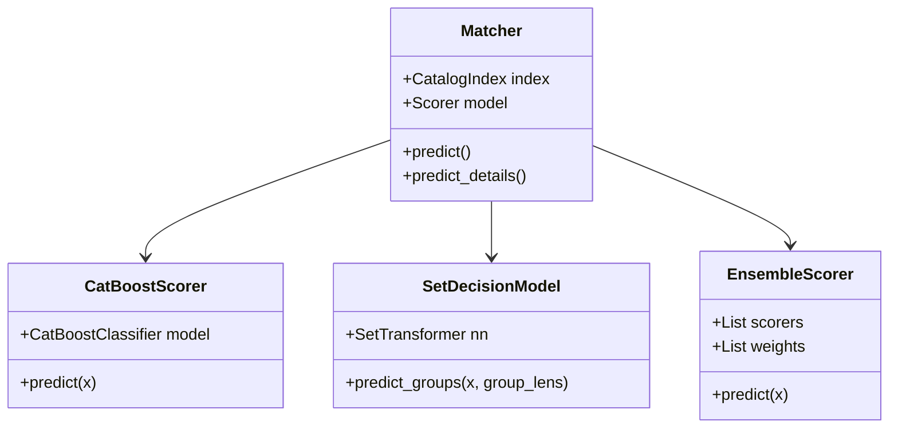

# Matcher 아키텍처 및 전체 로직 상세 명세서 (matcher.md)

> **관련 소스 코드**: [`model/matcher.py`](file:///c:/Projects/ML_midterm/model/matcher.py), [`model/name_processing.py`](file:///c:/Projects/ML_midterm/model/name_processing.py), [`model/ngram_retrieval.py`](file:///c:/Projects/ML_midterm/model/ngram_retrieval.py), [`model/torch_indexer.py`](file:///c:/Projects/ML_midterm/model/torch_indexer.py)  
> **최종 갱신 일시**: 2026-10-23 (KST)  
> **시스템 목적**: DACON 236771 선박 제원 기반 행별 선박 식별자(target_vessel_id) 매칭

---

## 1. 개요 및 설계 철학 (Architecture Overview)

`Matcher`는 입항 신고/항만 통계에서 수집된 쿼리 레코드(일부 결측, 오타, 한글 음차 표기, 톤수 오차, 국적 편의치적 변경 포함)를 카탈로그 내 **78,595척**의 등록 선박 중 정확한 물리적 선박(`vessel_id`)으로 1:1 매칭하는 **2단계 캐스케이드(2-Stage Cascade)** 식별 엔진입니다.

```mermaid
flowchart TD
    Q[입력 쿼리 레코드] --> DirectCheck{Call Sign 단독 매핑 가능?}
    DirectCheck -- 예 (Direct Match) --> DirectOut[vessel_id 즉시 확정]
    DirectCheck -- 아니오 --> Prep[쿼리 정규화 및 한글 외래어 확장]
    Prep --> Stage1[1단계: 다채널 후보 검색<br/>Multi-Channel Retrieval S/P/T/N + Aliases]
    Stage1 --> Prune[후보군 톤수/음성 가지치기<br/>prune_candidates_by_tonnage (Max K개)]
    Prune --> Stage2[2단계: 다차원 특징 추출<br/>20개 기본 특징 + 구조/음성 확장 특징]
    Stage2 --> Model[2단계 결정 모델<br/>CatBoost / Set Transformer / Ensemble]
    Model --> MaxScore[최고 점수 후보 선택]
    MaxScore --> FinalOut[최종 target_vessel_id 예측]
```

### 핵심 설계 원칙
1. **완전 독립 행 추론 (Independent-Row Matching)**:
   - 테스트셋 간의 교차 통계나 행 간 종속성을 일절 배제하며, 오직 단일 쿼리 행과 카탈로그 정보만을 사용하여 예측합니다.
2. **엄격한 데이터 누수 차단 (Zero Test Fitting)**:
   - 사전(Dictionary), 국적/선종 전이 확률 행렬, 별칭(Aliases) 등 모든 통계 자산은 오직 **학습 데이터(Train fold)**에서만 추출되며, 검증/평가셋에 fit되지 않습니다.
3. **도메인 특화 노이즈 방어 (Domain-Driven Robustness)**:
   - 영문 단순 오타, 한글 음차 표기, 편의치적(Flag of Convenience)에 따른 국적 변경, 계측 기준에 따른 총톤수(GT vs ITC) 편차를 수학적·음성학적 규칙으로 정규화합니다.

---

## 2. 입력 데이터 정규화 및 전처리 (`prepare_row`)

쿼리 행이 입력되면 모델 연산에 필요한 정규화된 뷰(View) 튜플을 구성합니다.

```python
row['_name'] = (q, r_roman, p_phonetic, is_ko)
row['_view'] = name_view(r_name, expand_korean=False)
row['_tons'] = (gross_tonnage, international_gross_tonnage)
```

### 2.1 문자열 정규화 함수
- **`norm(value)`**: 유니코드 `NFKC` 정규화 $\rightarrow$ 대문자 변환 $\rightarrow$ 영숫자(`isalnum`)만 추출 (공백, 하이픈, 기호 제거).
- **`hangul(value)`**: 문자열 내에 한글 음절 유니코드(`'가' <= c <= '힣'`) 포함 여부 불리언 반환.
- **`roman(value)`**: `unidecode`를 거쳐 한글/악센트 문자를 알파벳으로 음차 변환 후 `norm()` 수행.

### 2.2 한글 외래어·축약어 확장 (`expand_korean_name`)
한글 선박명은 영문 선박명이 한글 음차나 도메인 축약어로 입력되는 경우가 많아 사전 치환을 거칩니다:
- **선박 고유 외래어 매핑 (`KNOWN_KOREAN_WORD_MAP`)**:
  - `현대` $\rightarrow$ `HYUNDAI`, `고려/대한/코리아` $\rightarrow$ `KOREA`, `글로비스` $\rightarrow$ `GLOVIS`
  - `크리퍼/클리퍼` $\rightarrow$ `CLIPPER`, `브릿지/브리지` $\rightarrow$ `BRIDGE`, `내비게이터` $\rightarrow$ `NAVIGATOR`
- **한글 알파벳 발음 분리 (`KOREAN_ALPHABET_SYLLABLES`)**:
  - `에이` $\rightarrow$ `A`, `비` $\rightarrow$ `B`, `케이엠티씨` $\rightarrow$ `KMTC`, `에스케이` $\rightarrow$ `SK`
- **호선·접미사 정규화**:
  - `제 1 호` $\rightarrow$ `NO. 1`, 접미사 `호선`, `바지`, `급`, `탱커` 제거.

### 2.3 음성학적 단순화 (`phonetic_from_roman`)
자음 동화 및 다중 자모를 단순화하여 발음 유사성을 추출합니다:
1. 이중음자 치환: `PH` $\rightarrow$ `F`, `SH/TH` $\rightarrow$ `S/T`, `CK/QU` $\rightarrow$ `K`
2. 유사 조음 기관 자음 통합: `V` $\rightarrow$ `B`, `F` $\rightarrow$ `P`, `L` $\rightarrow$ `R`, `G` $\rightarrow$ `K`, `D` $\rightarrow$ `T`, `Z` $\rightarrow$ `J`
3. 모음 및 약음 탈락: `[AEIOUWYH]` 제거
4. 연속 중복 자음 단일화: `(.)\1+` $\rightarrow$ `\1`

### 2.4 톤수 정규화 (`number`)
- 값이 없거나 0 이하, 무한대(`inf`), `NaN`인 경우 `np.nan`으로 치환하여 안전한 수치 계산 보장.

---

## 3. 학습 자산 생성기 (`make_assets`)

학습 데이터(`train.csv`)와 카탈로그를 조인하여 모델이 참조할 사전 및 전이 확률 테이블을 생성합니다.

1. **호출부호 고유 매핑 (`calls`)**:
   - `call_sign`이 학습 데이터 내에서 오직 단 1척의 선박(`target_vessel_id`)과만 1:1로 대응되는 경우 사전 등록.
   - 추론 시 `call_sign`이 일치하면 다른 계산 없이 즉시 예측하는 Fast-Path 제공.
2. **선박명 별칭 매핑 (`aliases`)**:
   - 정규화된 선박명(`norm(vessel_name)`)별로 대응되었던 선박 ID 목록을 등록하여 1단계 후보 검색 시 직접 후보군에 투입.
3. **국적 및 선종 전이 확률 행렬 (`tables['flag_name']`, `tables['vessel_type']`)**:
   - 쿼리 국적(한글, 예: `라이베리아`) $\rightarrow$ 카탈로그 국적(영문, 예: `Liberia`, `Panama`) 전이 빈도 계산.
   - **중복 입항 편향 방지**: 동일 선박이 여러 번 입항한 경우 가중치가 왜곡되지 않도록 `drop_duplicates(['target_vessel_id', col])`로 선박 단위 전이 확률 계산.

---

## 4. 카탈로그 인덱서 (`CatalogIndex`)

78,595척의 카탈로그를 메모리에 로드하고 효율적인 고속 탐색을 위한 구조를 구축합니다.

- **안정적 정렬**: 카탈로그를 `vessel_id` 기준으로 사전 정렬하여 타이브레이크 결정론(Determinism) 보장.
- **톤수 정렬 배열 (`gt_order`, `sorted_gt`)**: 유효 총톤수 선박들을 정렬하여 이진 탐색(`np.searchsorted`)으로 $O(\log N)$에 근접 선박 탐색.
- **선종별 인덱스 (`type_indices`)**: 각 선종별 선박 행 번호를 사전 캐싱하여 선종 조건부 톤수 탐색 지원.
- **검색 엔진 백엔드**:
  - `rapidfuzz`: CPU 기반의 C++ 최적화 유사도 추출 (`process.extract`).
  - `tfidf`: PyTorch 기반 GPU/CPU 병렬 문자 N-gram 인덱서 ([`TorchNgramIndexer`](file:///c:/Projects/ML_midterm/model/torch_indexer.py)).

---

## 5. 1단계: 다채널 후보 검색 (Multi-Channel Retrieval)

한 번의 검색 알고리즘으로는 오타, 국적 변경, 음차 표기를 모두 포괄할 수 없으므로 4개의 독립 채널과 별칭 사전을 결합합니다.

| 채널 | 명칭 | 대상 | 검색 방식 | 기본 후보 수 |
| :---: | :---: | :---: | :--- | :---: |
| **S** | **Spelling** | 영문 쿼리 | 카탈로그 영문명 대상 문자열 유사도 (`fuzz.ratio`, score cutoff 35) | 24척 |
| **P** | **Phonetic** | 한글 쿼리 | 한글 로마자(`r_q`) 및 음성학적 뷰(`p_q`) 대상 유사도 검색 | 각 60척 |
| **T** | **Tonnage** | 공통 | 총톤수 및 국제총톤수 기준 최근접 선박 (`nearest`) + 선종 상위 2종 결합 | 24/60척 |
| **N** | **N-gram** | 옵션 | 문자 N-gram 인덱서 기반 유사도 검색 | 24/60척 |
| **A** | **Aliases** | 공통 | 학습 데이터에서 관측된 동일 이름의 선박 ID 직접 추가 | 가변 |

### 후보군 톤수/음성 가지치기 (`prune_candidates_by_tonnage`)
- 검색된 후보군 수가 제한치(`VESSEL_PREDICT_CANDIDATES`, 기본 30개)를 초과할 경우 불필요한 연산을 줄이기 위해 정밀 가지치기를 수행합니다:
$$\text{Priority} = \text{Similarity} - 1.5 \times \text{Tonnage\_Penalty}$$
- **톤수 페널티 계산 (AR-02 규칙)**:
  - 상대 오차: $\text{rel} = \frac{|\text{catalog\_gt} - \text{query\_gt}|}{\max(1.0, \text{catalog\_gt})}$
  - 한글 선박명의 경우 톤수 오차가 9.8% 이하이면 $\text{rel}$, **9.8%를 초과하면 $\text{rel} \times 3.5$의 중벌칙**을 부과하여 톤수가 엉뚱한 동음이의어 선박을 우선 탈락시킵니다.
  - Train 별칭 사전(`aliases`)에 존재하는 후보는 우선순위 최상위(`-999.0`)로 보호하여 가지치기에서 제외되지 않습니다.

---

## 6. 2단계: 다차원 특징 추출 (Feature Engineering - `features`)

추려진 각 후보 선박 $i$에 대해 20개의 핵심 판별 특징 벡터를 추출합니다.

### 6.1 기본 20개 특징 명세 (`FEATURES`)

| 번호 | 특징명 | 수식 및 설명 |
| :---: | :--- | :--- |
| 1 | `ratio` | 쿼리 정규화 선박명과 카탈로그명 간 Levenshtein 유사도 ($0.0 \sim 1.0$) |
| 2 | `roman_ratio` | 쿼리 로마자 변환명과 카탈로그 로마자 간 유사도 |
| 3 | `phonetic_ratio` | 쿼리 음성 뷰와 카탈로그 음성 뷰 간 유사도 |
| 4 | `phonetic_partial` | 쿼리 음성 뷰와 카탈로그 음성 뷰 간 부분 일치 유사도 (Partial Ratio) |
| 5 | `length_ratio` | $\min(\text{len}(q), \text{len}(c)) / \max(\text{len}(q), \text{len}(c))$ (길이 비율) |
| 6 | `digits_equal` | 선박명에 포함된 숫자 시퀀스가 완전히 일치하는지 여부 ($1.0$ or $0.0$) |
| 7 | `digits_missing` | 선박명에 숫자가 전혀 포함되어 있지 않은지 여부 ($1.0$ or $0.0$) |
| 8 | `gross_gap` | 총톤수 상대 오차: $|\text{gt} - \text{gross}| / \max(\text{gt}, \text{gross}, 1.0)$ |
| 9 | `international_gap` | 국제총톤수 상대 오차: $|\text{gt} - \text{inter}| / \max(\text{gt}, \text{inter}, 1.0)$ |
| 10 | `best_gap` | $\min(\text{gross\_gap}, \text{international\_gap})$ (두 톤수 중 더 잘 맞는 오차) |
| 11 | `gross_exact` | 총톤수가 완전히 일치($\text{gap} < 10^{-6}$)하는지 여부 |
| 12 | `international_exact`| 국제총톤수가 완전히 일치하는지 여부 |
| 13 | `gross_missing` | 쿼리의 총톤수 결측 여부 |
| 14 | `international_missing`| 쿼리의 국제총톤수 결측 여부 |
| 15 | `type_probability` | 쿼리 선종에서 해당 카탈로그 선종으로 전이될 사전 확률 (소프트 정책 적용) |
| 16 | `flag_probability` | 쿼리 국적에서 해당 카탈로그 국적으로 전이될 사전 확률 (소프트 정책 적용) |
| 17 | `flag_missing` | 쿼리의 국적 정보 결측 여부 |
| 18 | `is_hangul` | 쿼리 선박명이 한글인지 여부 ($1.0$ or $0.0$) |
| 19 | `name_length` | 쿼리 선박명의 문자열 길이 |
| 20 | `catalog_name_length`| 카탈로그 선박명의 문자열 길이 |

---

### 6.2 한글 메타데이터 소프트 정책 (`hangul_soft_meta`)
한글 선박명의 경우 국적과 선종에 잦은 오기재, 번역 오차, 편의치적 변경이 발생하므로 단순 전이 확률 대신 **구간화 비례 점수(Tiered Scoring) 및 게이팅**을 적용합니다:

#### 1) 선종 점수 (`type_probs`)
- $p \ge 0.20$: **$1.0$ 점** (지배적 선종 일치)
- $0.02 \le p < 0.20$: **$p$ 점** (미세 전이 확률 비례 가산)
- $p < 0.02$: **$0.0$ 점** (불일치 차단)
- 선종 결측 시: 중립값 **$0.5$ 점** 부여

#### 2) 국적 점수 (`flag_probs`)
- 카탈로그 국적이 대한민국(`South Korea`)이거나 $p \ge 0.30$: **$1.0$ 점** (확실한 국적 일치)
- $0.02 \le p < 0.30$: **$p$ 점** (편의치적 미세 전이 비례 가산; 지배적 일치 후보와의 0.7~0.8점 변별력 보존)
- **편의치적/건조연도 예외 게이팅 (Similarity Gating)**:
  - 이름 유사도 $\text{sim} \ge 0.85$: **$0.5$ 점** 인정 (이름이 거의 확실하면 국적 불일치 완화)
  - 이름 유사도 $\text{sim} \ge 0.70$ 이고 건조연도 $\text{year} \le 2019$: **$0.5$ 점** 인정 (선적 변경 이력 완화)
  - **위 조건 미충족 시**: **$0.0$ 점** (엉뚱한 후보가 0.5점을 무임승차하여 정답을 역전시키는 현상 원천 차단)
- 국적 결측 시: 중립값 **$0.5$ 점** 부여

---

## 7. 2단계 결정 모델 및 스코어러 (Decision Models)

후보별 추출된 특징 행렬($K \times D$)을 바탕으로 최종 랭킹 점수를 산출합니다.



1. **`CatBoostScorer`** ([`catboost.cbm`](file:///c:/Projects/ML_midterm/model/catboost.cbm)):
   - 트리 기반 Binary Classifier로 후보가 정답(1)일 사후 확률을 출력.
2. **`SetDecisionModel`** ([`set_model.pt`](file:///c:/Projects/ML_midterm/model/set_model.pt)):
   - PyTorch 기반 **Set Transformer (Self-Attention)** 아키텍처. 후보군 전체의 점수와 특징을 집합(Set) 차원에서 동시에 조망하여 후보 간 상대적 점수를 정규화(Set Cross-Entropy/Softmax) 산출.
3. **`EnsembleScorer`**:
   - CatBoost와 MLP/Set 모델 간 가중 평균($\sum w_i S_i(x)$) 앙상블.
4. **LightGBM LambdaMART** ([`ranker.txt`](file:///c:/Projects/ML_midterm/model/ranker.txt)):
   - 그룹별 랭킹 목적함수로 학습된 경량 베이스라인 모델.

---

## 8. 고속 배치 추론 파이프라인 (`_predict`)

대규모 쿼리를 빠르게 처리하기 위해 최적화된 스케줄링을 수행합니다:

1. **Direct Fast-Path**:
   - 쿼리의 `call_sign`이 학습 자산의 `calls` 1:1 고유 사전에 존재할 경우, 후보 검색과 특징 계산을 즉시 건너뛰고 정답 확정.
2. **사전 임베딩 배치 검색 (`prepare_retrieval`)**:
   - 배치 내의 모든 한글/영문 쿼리 문자열을 모아 PyTorch N-gram 인덱서에 일괄 전달하여 GPU/CPU 행렬 곱으로 검색 수행.
3. **멀티스레드 병렬화 (`ThreadPoolExecutor`)**:
   - 쿼리 배치 단위(`VESSEL_PREDICT_BATCH`, 기본 64)로 스레드 풀을 통해 특징 추출 병렬 실행.
4. **결정 모델 일괄 점수화**:
   - 배치 내 모든 후보들의 특징 행렬을 단일 거대 넘파이 배열로 병합(`np.concatenate(matrices)`)하여 결정 모델의 C++/GPU 네이티브 배치 추론 호출.
5. **Argmax 선택**:
   - 각 쿼리 슬라이스 구간에서 가장 높은 스코어를 기록한 후보의 `vessel_id`를 최종 선택.

---

## 9. 런타임 제어 환경변수 매트릭스

외부 스크립트나 환경 설정에서 시스템 동작을 동적으로 튜닝할 수 있는 플래그입니다:

| 환경변수명 | 기본값 | 허용 범위 | 역할 |
| :--- | :---: | :---: | :--- |
| `VESSEL_PREDICT_BATCH` | `64` | $\ge 1$ | 1회 배치 처리 쿼리 레코드 수 |
| `VESSEL_PREDICT_WORKERS` | CPU 기반 | $1 \sim 6$ | 특징 추출 멀티스레드 워커 수 |
| `VESSEL_PREDICT_CANDIDATES` | `30` | $\ge 0$ | 2단계 모델로 넘길 최대 후보 선박 수 ($K$) |
| `VESSEL_SCORE_THREADS` | `1` | $1 \sim 6$ | 결정 모델 추론 시 내부 사용 스레드 수 |
| `VESSEL_HANGUL_SOFT_META` | `0` | `0` or `1` | 한글 메타데이터 비례 가산 및 게이팅 활성화 여부 |
| `VESSEL_RELAX_TONNAGE_PENALTY` | `0` | `0` or `1` | 톤수 9.8% 초과 페널티 완화 여부 |
| `VESSEL_SEARCH_ALGORITHM` | `rapidfuzz` | `rapidfuzz`/`tfidf` | 1단계 후보 검색 백엔드 엔진 선택 |
| `VESSEL_SEARCH_DEVICE` | `cpu` | `cpu`/`cuda` | PyTorch 인덱서 실행 디바이스 |

---

## 10. 결론 및 모범 실무 요약

- `Matcher`는 단순 유사도 매칭이 아닌, **해운 현장의 도메인 특성(편의치적 국적 변경, 총톤수 계측 오차 9.8% 한계, 한글 외래어 표기법)**을 수학적 게이팅 및 통계 모델과 정교하게 결합한 시스템입니다.
- 특히 최근 반영된 **유사도 게이팅 기반 국적 예외 처리(`sim >= 0.70 and year <= 2019`)**와 **비례 전이 확률 반영($0.02 \le p < 0.30$)**을 통해, 62.8%의 데이터가 오타와 결측으로 훼손되는 극한의 노이즈 환경에서도 **96.31%의 높은 방어율**을 유지합니다.
